**English** | [简体中文](./README.zh-CN.md)

# DayZ Local Server Mod Manager V2

> **A Windows desktop app that makes heavily modded DayZ local servers and single-player PvE easier to set up and manage.**

**DayZ Local Server Mod Manager V2** simplifies managing heavily modded DayZ local servers and single-player PvE, letting you organize mod presets and load order, switch maps, configure the loot economy and server launch settings, and manage world-progress saves—all from one graphical application.

V2 is the successor to the original [DayZ Local Server Mod Manager](https://github.com/RichardVincent1324/DayZ-Local-Server-Mod-Manager), completely rebuilt with **C# / .NET 8 and WPF**.

---

## Screenshots

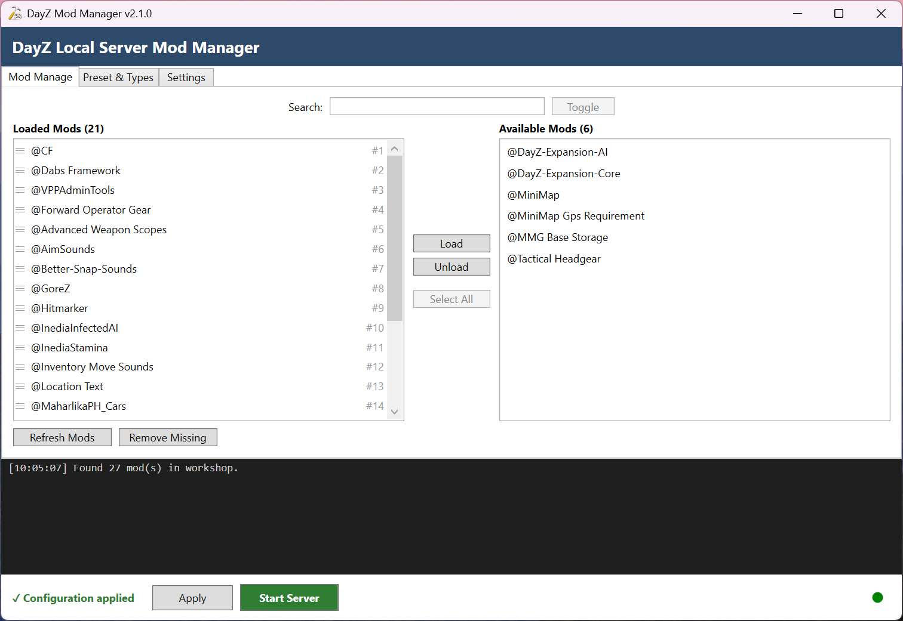 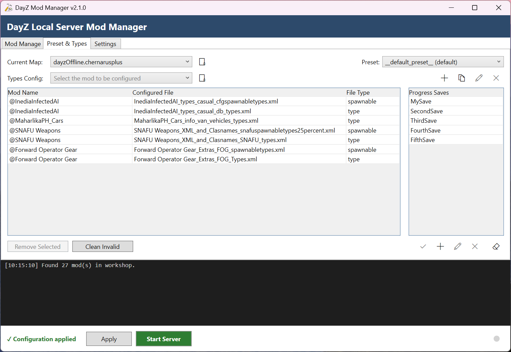

---

## ⬇️ Download

### [Download DayZ Local Server Mod Manager V2](https://github.com/RichardVincent1324/DayZ-Local-Server-Mod-Manager-V2/releases/latest)

**Latest stable release: v2.1.0**

* Windows x64
* Self-contained
* No separate .NET runtime installation required
* Single executable

> V2 manages an installed DayZ Server folder. It does **not** install or replace DayZ Server itself.

---

## What does V2 do?

Managing a heavily modded DayZ local server often means repeatedly dealing with Workshop folders, load order, junctions, batch-file parameters, mission files, XML configuration, map profiles, and save data.

V2 brings that workflow into one Windows application so you can spend less time editing files by hand and more time playing.

---

## Getting Started

### 1. Install DayZ and DayZ Server

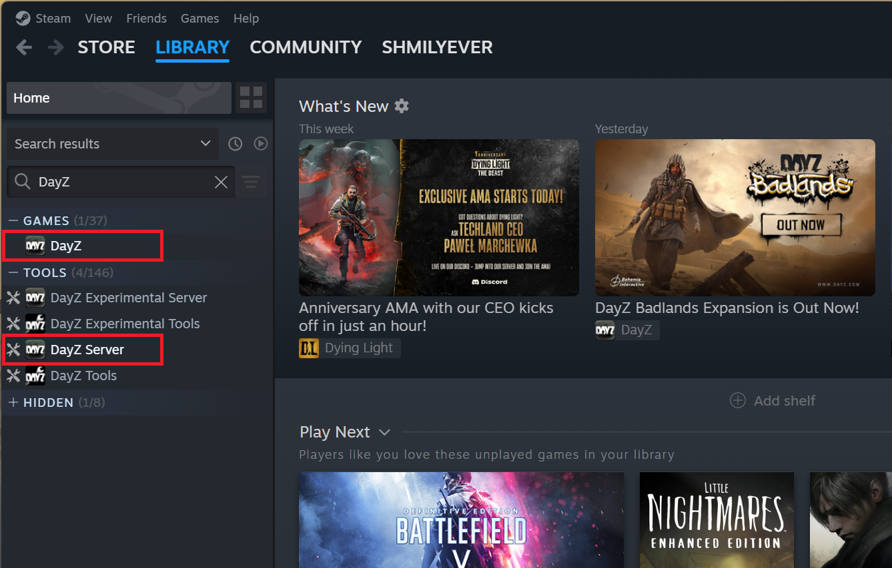

Before you begin, make sure you have:

- DayZ installed.
- DayZ Server installed (via Steam).
- Your DayZ Server folder available locally.

Make sure your DayZ Server folder contains its standard files, including `serverDZ.cfg` and the `mpmissions` directory.

### 2. Download V2

Download the latest release:

**https://github.com/RichardVincent1324/DayZ-Local-Server-Mod-Manager-V2/releases/latest**


### 3. Download the required launch batch file

The V2 repository does **not** currently include `LocalServer.example.bat`. Download it from the original project:

**https://github.com/RichardVincent1324/DayZ-Local-Server-Mod-Manager/blob/main/LocalServer.example.bat**

It is recommended to place both the downloaded executable and the batch file in your DayZ Server root. For example:

```text
D:\...\DayZServer\DayZModManagerV2-v2.1.x-win-x64.exe
D:\...\DayZServer\LocalServer.example.bat
```

Open `LocalServer.example.bat` and set `serverDirectory` to your actual DayZ Server folder:

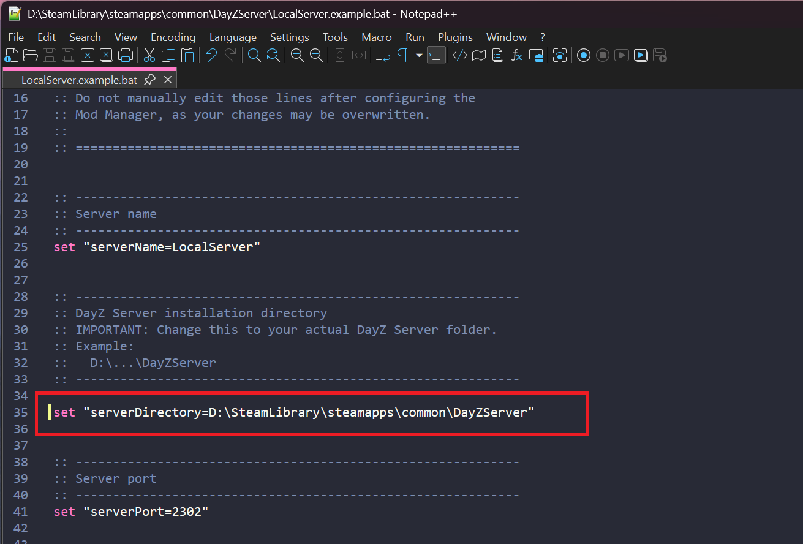

To find your DayZ Server folder, open Steam and select **DayZ Server → Manage → Browse Local Files**.

The template defines variables that V2 expects, including the following:

```bat
set "serverDirectory=C:\Path\To\DayZServer"
set "modList=-mod=;"
set "serverConfig=DayZ-Mod-Manager-V2\...\serverDZ.cfg"
set "serverProfile=DayZ-Mod-Manager-V2\...\profiles"
```

At minimum, set `serverDirectory` to your DayZ Server installation path. You can also adjust the server port, CPU count, and other launch settings as needed.

The template must contain all three manager-owned lines: `set "modList=-mod=...`, `set "serverProfile=...` and `set "serverConfig=...`. On every Apply, V2 rewrites these lines. `modList` receives the active preset's mod list, while `serverProfile` and `serverConfig` point to the active preset's `profiles` folder and `serverDZ.cfg`.

> [!WARNING]
> After V2 is configured to use the batch file, do not manually edit the `modList` section. V2 owns and rewrites that section when applying your mod configuration.

### 4. Configure the local server (signature verification off)

V2 is designed for local/solo play and does not manage DayZ `.bikey` / `.bisign` signature deployment.

For the intended local-server workflow, open `serverDZ.cfg`. The DayZ default value is:

```cfg
verifySignatures = 2;   // Verifies .pbos against .bisign files. (only 2 is supported)
```

Locate this existing line and change the value from `2` to `0`. Do not insert a duplicate entry.

```cfg
verifySignatures = 0;
```

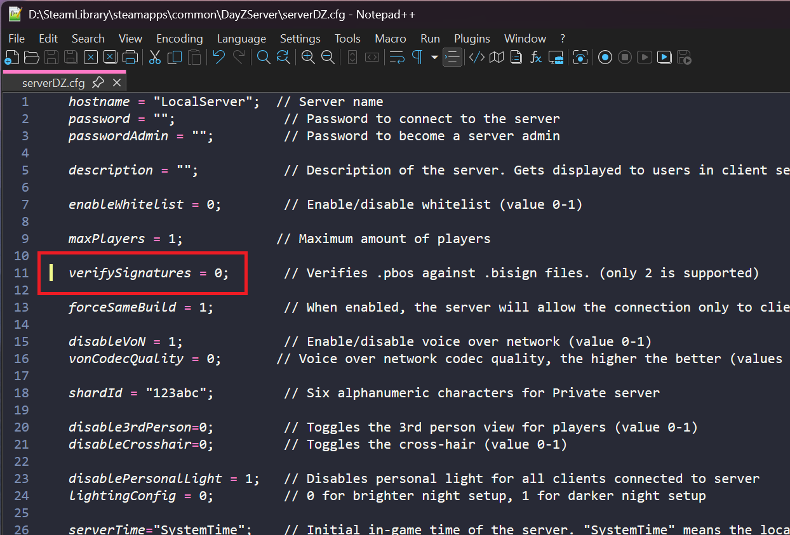

`verifySignatures = 0` disables PBO signature verification, which is required for this local-mod workflow.

> [!IMPORTANT]
> Do this **before you create any preset**, including `__default_preset__`. When a preset is created, it copies the current `serverDZ.cfg`. If you change only the server-root `serverDZ.cfg` after a preset already exists, that preset keeps its old copy and is not updated. To fix an existing preset, edit that preset's own `serverDZ.cfg`.

> [!CAUTION]
> This setup is intended for a private local server. Do not use V2 as a public-server security or signature-management solution.

### 5. Configure V2 settings

Open V2 and configure:

- **Workshop path** — the directory containing your installed `@...` mod folders:

  Valid examples:

  ```text
  1. <SteamLibrary>\steamapps\common\DayZ\!Workshop  → valid (recognized by name).

  2. ...\DayZ (with a !Workshop child)               → resolves to !Workshop → valid.

  3. ...\DayZ (no !Workshop) or an empty !Workshop   → valid by name, but discovery
                                                       warns if it finds 0 mods.

  4. D:\CustomModFolder directly containing @mod     → valid (recognized by content).
  ```

  Rejected examples:

  ```text
  1. ...\steamapps\common
     (its @mod folders are one level deeper)              → rejected.

  2. An unrelated directory with no direct @mod folder    → rejected.
  ```

- **Server path** — the directory containing `DayZServer_x64.exe` and `serverDZ.cfg`.
- **Batch file** — the `LocalServer.example.bat` file you prepared in the previous step.


### 6. ✅ Setup complete :tada: :confetti_ball:

> Your local DayZ server environment is ready. Continue below to learn about available features.

---

## Structure Overview

V2 organizes your server environment into a hierarchy:

- V2 discovers **maps** from the server's `mpmissions` directory. A folder is treated as a map only when it contains `cfgeconomycore.xml`. Common examples include `dayzOffline.chernarusplus`, `dayzOffline.enoch`, and `dayzOffline.sakhal`.
- Each map can contain multiple **presets**. A preset has its own `serverDZ.cfg`, mod order, types configuration, `type_files`, `profiles`, and independent live-world storage. Mod data written outside `profiles` is not isolated per preset.
- Every preset is assigned a unique `instanceId`.
- DayZ uses that `instanceId` to name the preset's live world folder: `mpmissions\<mapName>\storage_<instanceId>`.
- Stored progress saves live in the preset's `saves` folder. Each save contains a copy of the world data and a `save-meta.json` file.
- Because every preset has a distinct `instanceId`, presets never share or overwrite each other's live world or stored saves.

This structure lets you manage multiple maps, presets, and save slots without their world data overlapping.

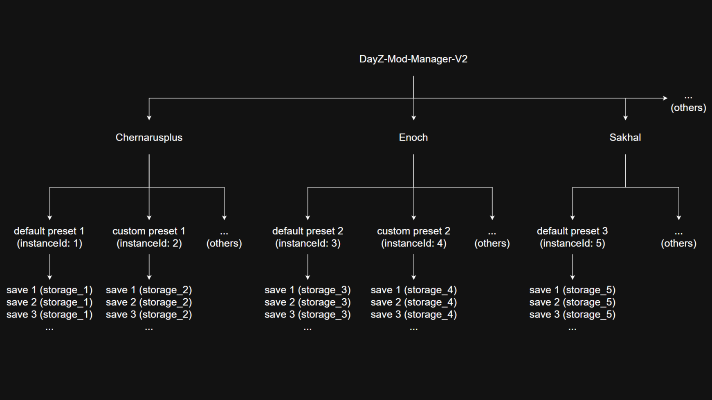

---

## Feature Guide

### 1. Drag to reorder mods

- While dragging, scroll the list using the mouse wheel, or hover near the top/bottom edge for auto-scrolling.
- The `#` markers represent the mods' actual load order in the launch batch file.

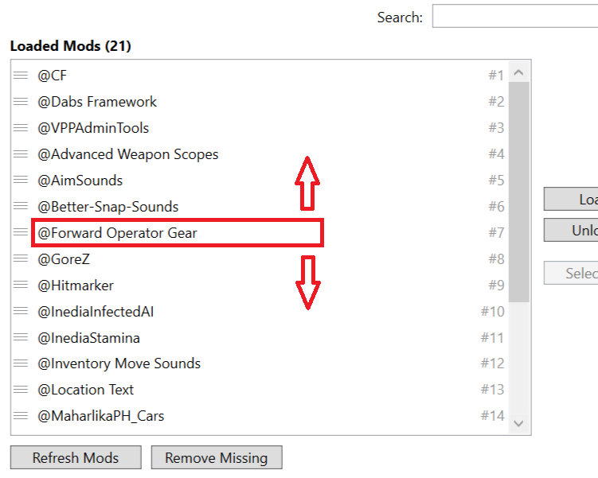

### 2. Type-file selection

- Do not check every detected type file without reviewing it first.
- Avoid selecting two files that target the same type template (the same template name with different data). DayZ uses the later entry for the same template, which can override the earlier one.
- For unrecognized files, use the **Open Mod Folder** button to inspect them before assigning a file type. Assigning a file to the wrong type may prevent the server from starting.
- When you check an unrecognized file, it is assigned the **Types** role by default. If it is a Spawnable Types file, expand the dropdown and choose **Spawnable**.

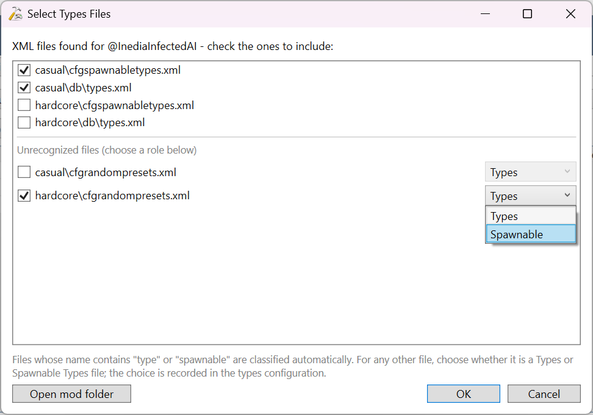 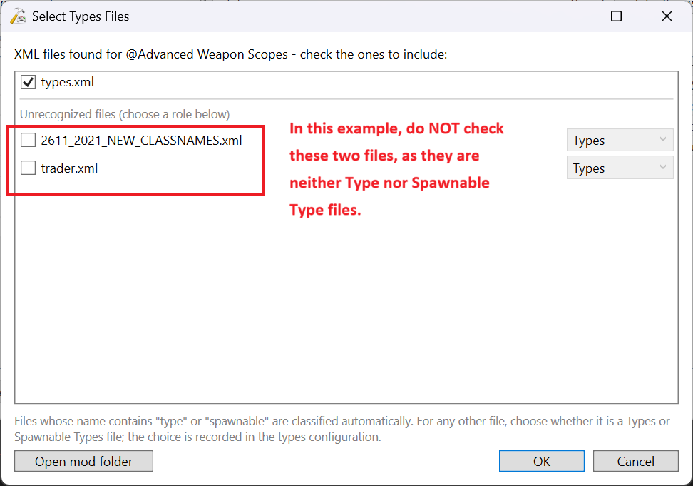

### 3. Folder shortcuts for frequently edited files

- The icon beside **Current Map** opens the active preset's `profiles` folder, where you can edit mod configurations such as VppAdminTools.
- The icon beside **Types Config** opens the active preset's `type_files` folder, which contains its configured type files. Mod authors provide these template files, which are copied from the Workshop; you can edit them if needed.

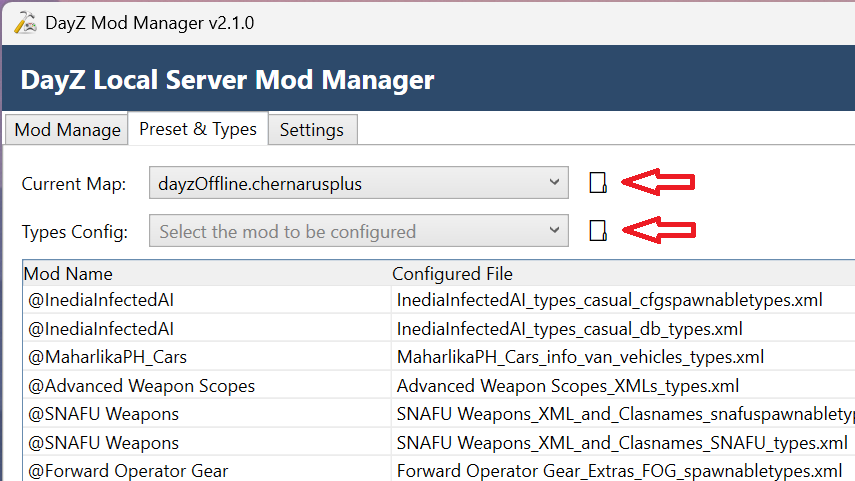

### 4. Edit a preset's server configuration

- Click either folder icon to open its folder, then go up one level to reach the preset folder.
- `serverDZ.cfg` is stored in that preset folder. Edit its settings as needed.

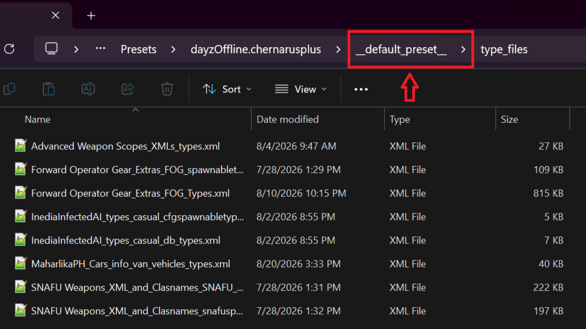 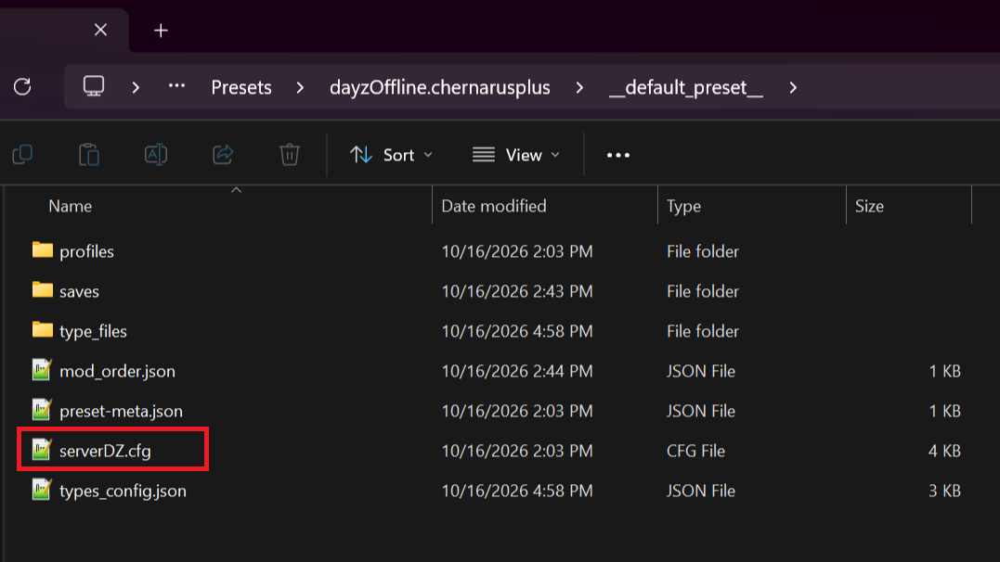

> [!WARNING]
> Do NOT alter the line **`instanceId = N;`**. It is fixed by the preset's `instanceId` stored in `preset-meta.json`; changing it points the server at a different `storage_<id>` and makes the preset fall out of sync.

### 5. Multi-select type files

- Click and drag to select multiple type files, or press `Ctrl+A` to select all.

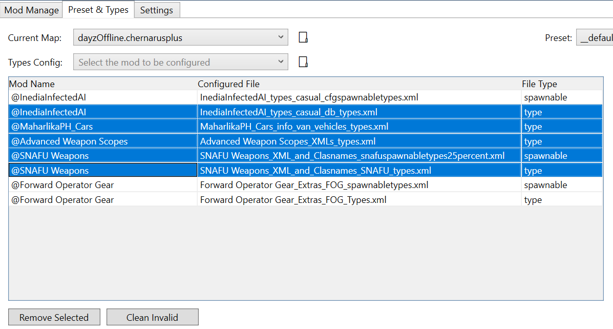

### 6. Live-world storage indicator

A small circular indicator in the bottom-right corner of the main window stays visible across all tabs and shows whether the active preset has a live world.

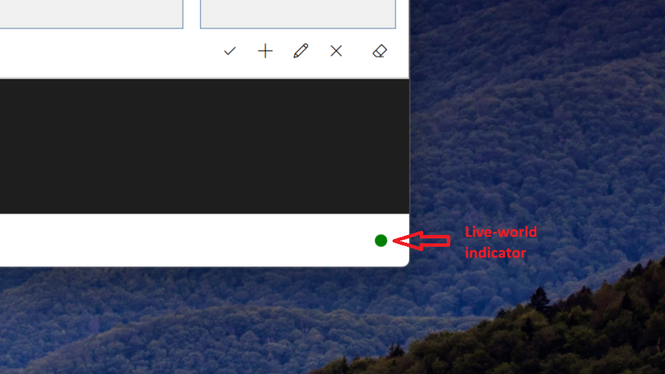


- **Green** — the active preset's live storage folder `mpmissions\<currentMapName>\storage_<instanceId>` exists on disk. Its tooltip shows the associated folder.
- **Light gray** — the folder does not exist. Its tooltip shows the expected `storage_<instanceId>` folder.
- The indicator checks only the active preset's own storage folder. Orphaned `storage_<id>` folders shown in the **Progress Saves** list never affect it.
- It updates automatically when switching presets or maps, applying configuration, or performing save / wipe world actions.

### 7. Important limitation: Incomplete mod-configuration isolation

Although presets isolate most server state, including `profiles`, `type_files`, mod junctions, preset-specific `serverDZ.cfg`, and per-preset world storage, **V2 cannot provide complete environment isolation for every possible mod**.

Some mods write runtime‑generated configuration or data folders **outside the preset‑owned `profiles` directory**.
A common example is `DayZ-Expansion-AI`, which maintains a separate set of configuration files here:
```
mpmissions\<mapName>\expansion
```
Files in these locations are outside V2’s preset-managed scope. They are **not copied, swapped, or isolated when you switch presets**.

All presets for the same map will share these external mod files; edits to those files will affect every preset on that map.

This is intentional: automatically handling arbitrary mod-specific external directories would add substantial complexity, and this tool **does not aim to provide complete mod-environment isolation**.

Mods that keep all their configuration within the `profiles` folder are isolated as expected.
If you use mods that write data outside `profiles`, you must manually back up, manage, or swap those external folders when using multiple presets on the same map.

### 8. Optional: Remove BattlEye for local-only gameplay
Since V2 is built exclusively for private local single‑player servers, **the BattlEye anti‑cheat provides no benefit for this use case**. It only introduces unwanted background CPU and I/O performance overhead.

You can use the community tool **DayZ-Server-Battleye-Remover** to patch your `DayZServer_x64.exe` and bypass BattlEye:
> https://github.com/JonathanEke/DayZ-Server-Battleye-Remover

> [!CAUTION]
> This executable patch is **for local private use only**. Never run this modified binary on any publicly reachable server. This is an external third‑party tool and is not maintained by this project; please report any bugs or problems to its original GitHub repository.

### 9. Server‑side mod loading (-serverMod=) is not managed
This tool focuses on managing the -mod= parameter and full preset environments, which covers most mod use cases for local single‑player / PvE gameplay.

`-serverMod=` (server‑side‑only mod loading) has very few practical use‑cases in local solo play, and the maintenance overhead far outweighs the benefit. Consistent with the limitation described in point 7 above, this tool does **not** aim to support every possible mod‑loading scenario.

**For advanced users who require `-serverMod=`:**
> Important note: DZMMV2 will **not create directory junctions** for mods added to `-serverMod=`. Mods here cannot reference files inside Steam’s `!Workshop` folder. Physical copies of mod folders must reside directly inside your DayZServer root directory. This batch‑file variable will never be overwritten or modified by the Mod Manager during Apply or preset switching.

Manual setup steps:
1. Find your target server‑only mod folder (folder starting with `@`) inside Steam’s `!Workshop` directory. Copy the **complete physical mod folder** into your `DayZServer` root folder.
2. Open your launch `.bat` file and populate the `serverMod` variable with your mod names. Separate multiple mods using semicolons `;`.

Example batch configuration:
```bat
set "serverMod=-serverMod=@MyServerMod;@AnotherServerOnlyMod"
```

---

## Features

### Mod management

- Find installed DayZ mods in your configured Workshop folder or custom folder.
- Use the **Loaded** and **Available** lists to see which mods are active and which are ready to load.
- Find a mod quickly with the search bar.
- Load or unload mods directly, including from search results.
- Drag and drop mods to change the order in which the server loads them.
- Use **Remove Missing** to remove list entries for mods that are missing from disk.
- If a loaded mod folder is missing, V2 marks that mod as missing.
- Click **Apply** to apply the selected mods to your local server.

### Junctions and batch-file management

- When you load mods, V2 gives the server access to them through Windows folder links called junctions. These links sit in a separate subfolder for each preset inside `DZMMV2_ModList` (for example `DZMMV2_ModList\1\@CF`), named using that preset's `instanceId`. Switching presets does not recreate or delete another preset's junctions.
- The mod paths are written relative to the DayZ Server root folder, for example `DZMMV2_ModList/1/@CF`. (In the batch file, these paths use forward slashes.)

```
📂 DZMMV2_ModList/
├── 📂 1/                    → Junction folder for preset with instanceId 1
│   ├── 🔗 @CF               → Junction → Steam Workshop\...
│   └── 🔗 @AnotherMod       → Junction → Steam Workshop\...
│
├── 📂 2/                    → Junction folder for preset with instanceId 2
│   ├── 🔗 @CF
│   └── ...
│
└── 📂 3/ ...
```

- When you click Apply, V2 updates the `modList` section of your batch file. This section is managed by V2.
- If you load many mods, V2 splits the list across several valid `cmd` lines, with ten mod entries per line, instead of using one very long line.
- When you click Apply, V2 checks the existing junctions and updates them to match the selected setup.
- Deleting a preset also deletes that preset's junction folder.

### Preset & Types

#### Map and preset configuration

- Find maps by checking the server's `mpmissions` directory. A mission folder is treated as a map if it contains `cfgeconomycore.xml`.
- Choose the map you want to use from the dropdown list.
- Update the `template` line (DayZ uses `template` to store the map name) in the active preset's `serverDZ.cfg`.

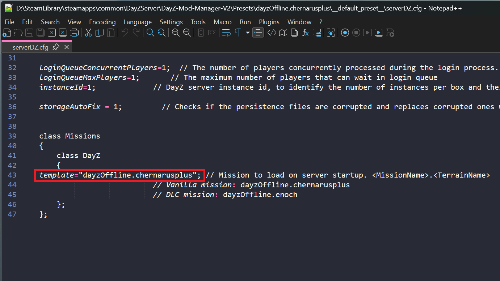

- Update the batch file's `serverProfile` and `serverConfig` lines so the server uses the active preset's `profiles` folder and `serverDZ.cfg`.

#### Type-file discovery and type assignment

- Search through every folder inside a mod to find all XML files.
- V2 automatically recognizes files whose names contain `type` or `spawnable`. Other XML files appear separately at the bottom of the window, where you can assign each file the **Types** or **Spawnable** type.
- Use **Open Mod Folder** to inspect the mod's XML files in File Explorer before assigning a type for an unrecognized file.
- Copy the XML files you select from the Workshop into the active preset's `type_files` folder.
- Save each file's assigned type in `types_config.json`. V2 uses it to set the `type` attribute and to put types entries before spawnabletypes entries for each mod in `cfgeconomycore.xml`.
- The types list shows **Mod Name**, **Configured File**, and **File Type** (`type` or `spawnable`), so you can quickly check each file's assigned type.


#### Loot‑economy integration
- Add a CE configuration block to `cfgeconomycore.xml`, between `<economycore>` and `<classes>`, so DayZ can read the selected type files.
- The CE block always uses the same folder path: `db/DZMMV2_Types`.
  In each mission, a Windows junction at `mpmissions/<mapName>/db/DZMMV2_Types` points to the active preset's `type_files` folder.
  When you switch presets, V2 points that mission junction to the new preset. When you switch maps, it sets up the junction for the newly selected mission. The `folder` attribute inside `<ce>` always stays `db/DZMMV2_Types`. V2 never copies the type files themselves into mpmissions; it only creates the db/DZMMV2_Types junction.
- `db/DZMMV2_Types` is a folder link (junction), not a separate copy of the files.
- Editing XML files through the `DZMMV2_Types` junction (for example, with VPP Admin Tool) changes the actual files in the active preset's `type_files` folder.
- Do not rename, delete, or change `DZMMV2_Types` yourself; V2 manages it when you click Apply. Saving, loading, or wiping a world does not change where the junction points. If the junction breaks or points to the wrong place, click Apply to repair it.
- If you manually delete V2's data directory, a broken junction may be left under `db/`. The junction itself does not contain the type files. If you need to clean it up, delete only the junction—not the folder it points to.

- V2 labels its own `<ce>` block with `dzmmv2-managed-by="DayZ-Mod-Manager-V2"`. When you click Apply, switch maps or presets, or edit type files, V2 updates only the `<file>` entries in that marked block. The `<ce>` element and marker stay in place even if the block has no entries.

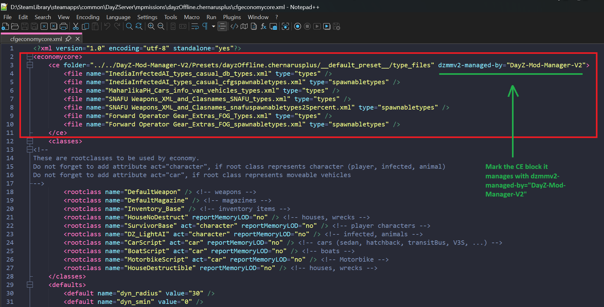

- V2 leaves other `<ce>` blocks alone, including the older V2 `./db/ModTypes` block and blocks created by other tools. It does not change entries it does not manage.


#### Type-file maintenance

- Show XML files that are present in `type_files` but not recorded in `types_config.json` as `(untracked)`. This keeps leftovers from manual edits, failed deletions, or older versions visible so you can remove them. V2's managed `<ce>` block references only tracked files.
- Ask you to confirm before overwriting or deleting configured type files.
- Provide `Remove Selected` and `Clean Invalid` tools to clean up the configured files.
- Warn you before editing types if the preset already has a saved world or a live world. DayZ reads these files when a world is first created, so changes affect future item spawns and newly created saves—not items already spawned in the current world.
- Use the buttons beside **Types Config** and **Current Map** to open the active preset's `type_files` or `profiles` folder in File Explorer.

> **Upgrading from an older V2 release:** older versions created a `<ce>` block without a marker. V2 cannot tell that this block belongs to it, so it leaves the old block in place and creates a new marked block beside it. DayZ reads <file> entries from every <ce> block, so until you remove the old block yourself, the same type files may be referenced twice.Manually remove any unmarked `<ce>` block created by an older V2 version. In 2.0.x these blocks point to `db/ModTypes`, for example `<ce folder="db/ModTypes">...</ce>`. V2 leaves blocks created by other tools untouched. If it finds such a block, it logs a warning but does not migrate it automatically.

### Presets and progress saves

V2 is organized around **presets**. Each preset is a separate DayZ server setup with its own `serverDZ.cfg`, mod order, types configuration, `type_files`, profiles, and `instanceId`. A **save** is a snapshot of the world at a particular point in time. A preset can have multiple saves; those saves belong to the same preset and therefore share the same server setup.

#### Creating and configuring presets

- Each map gets a `__default_preset__` the first time you apply that map. This preset cannot be renamed or deleted. V2 creates it either during the first run (for the first map it finds, once the server path and batch file are set) or when you select that map.
- Use **[Add Preset]** to create your own preset. Its `profiles` folder starts empty, and presets never share profile data.
- Duplicate the current preset to copy its `serverDZ.cfg`, mod order, types configuration, and generated type files. **Profiles and saves are not copied.** You can duplicate it for another map. In that case, V2 rewrites the `template` line in the copied `serverDZ.cfg` to the target map's name and assigns a new `instanceId`.
- Preset names can use letters, numbers, `.`, `_`, `-` and `+`, but **cannot contain spaces**. They also cannot end with a dot or use a reserved Windows device name. V2 passes the active preset's `serverDZ.cfg` / `profiles` paths to the server without quotes (`-config=%serverConfig%`, `-profiles=%serverProfile%`). DayZ Server does not accept a quoted `-config` value, so spaces in a preset name would stop the server from starting.
- When V2 creates a preset, it copies an existing `serverDZ.cfg` and changes only `template` (the map) and `instanceId`:
  - A duplicated preset copies its source preset's `serverDZ.cfg`. If that file is missing, V2 cannot create the duplicate.
  - A new user-created preset copies the map's `__default_preset__\serverDZ.cfg`. If that file is missing, V2 cannot add the preset.
- `__default_preset__` copies `<serverPath>\serverDZ.cfg`. If that root config has a valid `instanceId` that no preset is using yet, the default preset keeps it. If another preset already uses that ID, V2 assigns a new one and logs a warning. Each ID identifies a subfolder in `DZMMV2_ModList`, so only one preset can use the root config's ID.
- V2 copies `serverDZ.cfg` only when a preset is first created. If you later delete an existing preset's `serverDZ.cfg`, V2 will report that it is missing and will not recreate it; restore the file manually before using the preset again. V2 rebuilds a missing `preset-meta.json` automatically **only for `__default_preset__`**, keeping its `instanceId`. If a user-created preset is missing this file, V2 reports the preset as incomplete. To recreate the default preset, delete its `__default_preset__` folder; V2 creates it again the next time you apply the map.

#### World and save management

- Presets for the same map keep separate worlds by using different `instanceId` values. Switching presets therefore does not overwrite another preset's live world (`storage_<instanceId>`).
- **Add Save** copies the active preset's current world progress. It copies `storage_<instanceId>` and adds `save-meta.json`. **Add Save works only after the live world storage exists**, so start the server at least once first. Check that the live-world indicator is green before adding a save.
- Loading a save restores the world only. It does not change the preset's mods, types, or profiles.
- Use Wipe World to delete the preset's live world storage and start with a fresh world next time you launch the server. The live-world indicator turns gray.
- The save list marks the `storage_<id>` that do not belong to any preset as `(orphaned)`. They may be left by a deleted preset or may predate V2, and you can delete them from the list.
- Deleting a preset removes its preset folder (including `serverDZ.cfg`, profiles, saves, and `type_files`) and its `DZMMV2_ModList\<instanceId>` junction folder. It does not delete the live world `storage_<instanceId>` under `mpmissions/<mapName>`. That world appears as `(orphaned)` storage in the **Progress Saves** list. You can delete it there separately if you no longer need it.
- You must stop the DayZ Server before using Save, Load, Wipe, or Rename Save, or switching, renaming, or deleting a preset.
- Loading a save replaces the current live-world storage with the saved copy.

> **Existing worlds:** V2 connects a preset to an existing `storage_<instanceId>` folder when the folder's ID matches that preset's `instanceId` and the folder is under `mpmissions/<mapName>`. Ownership is decided only by this ID match; V2 does not provide a separate "attach this folder to a preset" action. Worlds with no matching preset appear as `(orphaned)` in the **Progress Saves** list and can be deleted.

### Settings and data storage

V2 stores its settings and save data in a dedicated folder.

Before a server path is configured:

```text
%LOCALAPPDATA%\DayZ-Mod-Manager-V2
```

After a server path is configured:

```text
<serverPath>\DayZ-Mod-Manager-V2
```

After you change the server path and Apply successfully, V2 moves its data files to the new location. A small pointer file in `%LOCALAPPDATA%` remembers which data folder to use the next time V2 starts.

The data folder contains:

```text
DayZ-Mod-Manager-V2\
├─ settings.json
└─ Presets\
   └─ <mapName>\
      ├─ __default_preset__\
      │  ├─ preset-meta.json
      │  ├─ serverDZ.cfg
      │  ├─ mod_order.json
      │  ├─ types_config.json
      │  ├─ type_files\
      │  ├─ profiles\
      │  └─ saves\
      │     └─ <saveName>\
      │        ├─ save-meta.json
      │        └─ storage_<id>\
      └─ <userPreset>\
         └─ (same structure)
```

V2 stores each preset's `instanceId` in `preset-meta.json` (and can fall back to `serverDZ.cfg`). This ID tells DayZ which live-world folder to use: `mpmissions\<mapName>\storage_<instanceId>`.

The Settings tab also has **Auto-clean server log files on startup**. When enabled, V2 deletes `.rpt` and `.log` files from the active preset's `profiles` folder only if there are more than 20 of them in total. If there are 20 or fewer, it leaves them alone. This option is **off by default**.

Stop the DayZ server before switching maps or presets, editing types configuration, loading a save, or wiping the world.

---

## Upgrading from an earlier version

> [!IMPORTANT]
> Version **v2.1.0** changes the app's data/file layout, so it is not compatible with the layout used by older V2 versions. Starting with a clean setup is strongly recommended. Back up anything you want to keep first.

### Remove the older V2 installation

1. Launch the old V2 build of DayZ Mod Manager.
2. Unload all mods via the **Mod Manage** tab, then remove all configured types files using the **[Remove Selected]** button in the **Preset & Types** tab.
3. Close the application and delete the old V2 executable (for example, `DayZModManagerV2-v2.0.x-win-x64.exe`).
4. Delete the `DayZServer\DayZ-Mod-Manager-V2` folder, the old `DayZServer\ModList` folder (from older V2 versions), and `%LOCALAPPDATA%\DayZ-Mod-Manager-V2`.

Deleting `ModList` removes the folder links, not the Workshop mods they point to. Delete the junction folder itself; do not delete files by browsing through a junction.

### Install the new version

1. Download the latest V2 executable from the [V2 releases page](https://github.com/RichardVincent1324/DayZ-Local-Server-Mod-Manager-V2/releases/latest).
2. Download the latest `LocalServer.example.bat` from the [original repository](https://github.com/RichardVincent1324/DayZ-Local-Server-Mod-Manager/blob/main/LocalServer.example.bat). Do this again for every V2 update, even if you already have an older copy of the batch file.
3. Place both files in your DayZ Server root folder.
4. Configure V2 again as described in [Getting Started](#getting-started).

---

## Required batch-file notes

The `LocalServer.example.bat` file is required for V2's normal launch workflow. It provides the batch-file structure that V2 is designed to update and use.

The template includes these important settings:

- `serverDirectory` — the folder where DayZ Server is installed.
- `modList` — **required**; V2 updates this line when you apply your setup.
- `serverProfile` — **required**; the active preset's profiles folder (updated by V2 when you click Apply).
- `serverConfig` — **required**; the path to the active preset's `serverDZ.cfg` (updated by V2 when you click Apply; the template value is only a placeholder).

The template starts `DayZServer_x64.exe` and can also launch the DayZ client through Steam. You can rename the batch file to anything you like; V2 uses whichever file you select in Settings.

All three lines (`modList`, `serverProfile`, `serverConfig`) must be present. If one is missing, V2 shows an error and blocks Apply, map or preset switching, and Start Server.

**Without this batch-file setup, V2 cannot update or start the expected launcher, so Apply, map/preset switching, and server launching will not work as intended.**

---

## Important: Local servers and solo play only

V2 is designed specifically for local DayZ environments, solo play, and single-player PvE.

It does **not** provide a complete public-server administration stack and does not manage:

- `.bikey` deployment.
- `.bisign` files.
- Server-side signature verification workflows.
- Remote/headless server administration.

If you run a public or shared dedicated server that requires signature verification and key management, use tools designed for that purpose.

---

## Server and file layout

Once set up, your server folders may look like this:

```text
<serverPath>\
├─ DayZ-Mod-Manager-V2\
│  ├─ settings.json
│  └─ Presets\
│     └─ <mapName>\
│        └─ <presetName>\
│           ├─ preset-meta.json
│           ├─ serverDZ.cfg
│           ├─ mod_order.json
│           ├─ types_config.json
│           ├─ type_files\
│           ├─ profiles\
│           └─ saves\
├─ LocalServer.bat
├─ DZMMV2_ModList\
│  ├─ 1\                    -> junction folder for preset with instanceId 1
│  │  ├─ @CF                -> junction pointing to Workshop mod
│  │  └─ @AnotherMod        -> junction pointing to Workshop mod
│  └─ 2\                    -> junction folder for another preset
│     └─ ...
├─ mpmissions\
│  └─ <mapName>\
│     ├─ cfgeconomycore.xml
│     ├─ db\
│     │  └─ DZMMV2_Types         -> junction pointing to the active preset's type_files
│     └─ storage_<instanceId>\
└─ DayZServer_x64.exe
```

The batch file's `modList`, `serverProfile`, and `serverConfig` lines tell the server to use the active preset's mods, `profiles` folder, and `serverDZ.cfg`. The marked `<ce>` block in `cfgeconomycore.xml` uses the fixed mission folder `db/DZMMV2_Types`. When you switch presets, the junction at that path points to the new preset's `type_files` folder, so V2 does not copy type files into the mission.

---

## Safety behavior

V2 is designed to reduce accidental damage to your local server setup:

- Apply validates the environment before committing the configuration.
- New junctions are prepared before old ones are cleaned up, so a failure during cleanup does not leave the server without a usable mod path.
- A failed batch-file write does not remove junctions still referenced by the existing launcher configuration.
- Before launch, V2 verifies that the mission-local type-files junction points to the active preset; a missing or mismatched junction blocks launch until Apply is run again.
- A failed save/load copy reports an error. Note that loading a save deletes the live world before copying the stored one, so a failure partway through can leave the live world partially restored — keep backups of important worlds.
- Save / Load / Wipe World operations (and preset switch / rename / delete) are blocked while the DayZ Server process is running.
- Types configuration asks before overwriting or deleting managed files.
- Starting the server is blocked when loaded mods are missing or when referenced type files are absent.
- Apply, map/preset switching and Start Server are blocked when the launch batch file is missing any manager-owned line (`modList`, `serverProfile`, `serverConfig`).
- Manager-owned changes are limited to the lines and files V2 is responsible for. V2 only reads the server-root `serverDZ.cfg`; it never writes it.

Even so, we strongly recommend backing up important server configuration and save data before making major changes.

---

## Requirements

### For users

- 64-bit Windows.
- DayZ Standalone.
- An installed and working local DayZ Server.
- Installed Workshop mods, if you plan to use mods.
- A compatible launch `.bat` file. **Download `LocalServer.example.bat` from the original repository as described above.**

### For developers

- Windows.
- [.NET 8 SDK](https://dotnet.microsoft.com/download/dotnet/8.0).
- Visual Studio 2022 or another development environment that supports .NET 8 and WPF.

---

## Build from source

To get the source code, clone the repository:

```powershell
git clone https://github.com/RichardVincent1324/DayZ-Local-Server-Mod-Manager-V2.git
cd DayZ-Local-Server-Mod-Manager-V2
```

Build the project:

```powershell
dotnet build DayZModManagerV2.sln
```

Start the app from source:

```powershell
dotnet run --project src/DayZModManager.App
```

Run the automated tests:

```powershell
dotnet test DayZModManagerV2.sln
```

### Publish a self-contained Windows x64 build

```powershell
dotnet publish src/DayZModManager.App `
  -c Release `
  -r win-x64 `
  --self-contained true `
  -p:PublishSingleFile=true `
  -p:IncludeNativeLibrariesForSelfExtract=true `
  -p:EnableCompressionInSingleFile=true `
  -p:DebugType=None `
  -p:DebugSymbols=false
```

---

## Project structure

```text
src/
├─ DayZModManager.Core/       # domain logic and services
└─ DayZModManager.App/        # WPF UI / MVVM application

tests/
├─ DayZModManager.Core.Tests/
└─ DayZModManager.App.Tests/
```

V2 keeps the main server and mod-management logic separate from the Windows interface. This makes the code easier to maintain and test.

---

## V1 → V2

V2 was rebuilt from the ground up, rather than just given a new interface.

| V1 | V2 |
| --- | --- |
| PowerShell | C# / .NET 8 |
| PowerShell GUI | WPF / MVVM |
| Script-oriented architecture | Structured application architecture |
| Root-level mod junction workflow | Dedicated `DZMMV2_ModList` junction folder |
| Basic mod/types workflow | Integrated map, types, untracked-file and safety handling |
| Lack of save management | Named progress saves with metadata and world snapshots |
| Limited testability | Dedicated Core/App test projects |

The original repository is still needed because it hosts the `LocalServer.example.bat` file required by V2.

---

## Troubleshooting

### V2 cannot find or update my batch file

Make sure you downloaded the batch template from the original repository, placed it in your DayZ Server folder, and selected it in V2 Settings. It must contain all three V2-managed lines: `set "modList=-mod=...`, `set "serverProfile=...` and `set "serverConfig=...`. If one is missing, V2 shows an error and blocks Apply and Start Server.

**Template:**
https://github.com/RichardVincent1324/DayZ-Local-Server-Mod-Manager/blob/main/LocalServer.example.bat

### The server does not start

Try running your batch file manually, then check the following:

- `serverDirectory` points to your DayZ Server folder.
- `DayZServer_x64.exe` is present in that folder.
- `serverDZ.cfg` exists both in the server root **and** in the active preset folder.
- The server port and other launch settings are correct.
- `verifySignatures = 0;` is set in the **active preset's** `serverDZ.cfg`. For presets created earlier, check the preset config itself; changing the server-root config later does not update existing presets.
- V2 does not report any missing mods or type files when you click Start Server.

### Mods do not load correctly

Check the following:

- The Workshop path points to the folder that contains your `@...` mod folders.
- The mods you want are in the **Loaded** list.
- Apply finished without an error.
- The generated `DZMMV2_ModList\<instanceId>` folder links exist.
- The selected batch file contains the mod list written by V2.
- `verifySignatures = 0;` is set for this local/solo setup.

### Custom items do not spawn

In **Preset & Types**, check that the required XML files are in the active preset's `type_files` folder and listed in `cfgeconomycore.xml`.

Changing type files does not change items that have already spawned in the current world. To apply the changes to a fresh world, wipe the world or start from a new save.

### Add Save reports that no storage folder exists

Start the server at least once so DayZ creates the world folder. `Add Save` copies the live `storage_<instanceId>` folder, so you cannot save until that folder exists.

### Save / Load / Wipe World is unavailable

Stop DayZ Server first. V2 blocks save and preset operations that can change the world while the server is running.

### A preset is missing or incomplete

V2 reports what is missing, such as the preset folder, `preset-meta.json`, or `serverDZ.cfg`. For `__default_preset__`, delete its folder and V2 will recreate it the next time you apply the map. For a user-created preset, restore the missing file, or delete and recreate the preset. The live world of a deleted preset remains as `(orphaned)` storage and can be removed from the save list.

---

## Contributing

Bug reports, suggestions, and improvements are welcome.

When reporting a problem, please tell us:

- What you were trying to do.
- What you expected to happen.
- What actually happened.
- Any relevant error messages or screenshots.
- Your DayZ/server settings, when relevant.

Use this repository to report issues or submit pull requests.

---

## License

This project is licensed under the [MIT License](LICENSE).

---

## Disclaimer

This is an independent community-made tool.

**DayZ** is a trademark of Bohemia Interactive. This project is not affiliated with Bohemia Interactive or endorsed by the company.

---

## Links

- [Download the latest V2 release](https://github.com/RichardVincent1324/DayZ-Local-Server-Mod-Manager-V2/releases/latest)
- [V2 repository](https://github.com/RichardVincent1324/DayZ-Local-Server-Mod-Manager-V2)
- [Original V1 repository](https://github.com/RichardVincent1324/DayZ-Local-Server-Mod-Manager)
- [Required `LocalServer.example.bat` template](https://github.com/RichardVincent1324/DayZ-Local-Server-Mod-Manager/blob/main/LocalServer.example.bat)
