# DayZ Local Server Mod Manager V2

> **A Windows desktop mod manager for heavily modded DayZ local servers and single-player PvE.**

**DayZ Local Server Mod Manager V2** brings mod selection, load order, junction management, launch-batch configuration, map switching, `types.xml` integration, and world-progress saves into one graphical application.

V2 is the successor to the original [DayZ Local Server Mod Manager](https://github.com/RichardVincent1324/DayZ-Local-Server-Mod-Manager), completely rebuilt with **C# / .NET 8 and WPF**.

---

## Screenshots

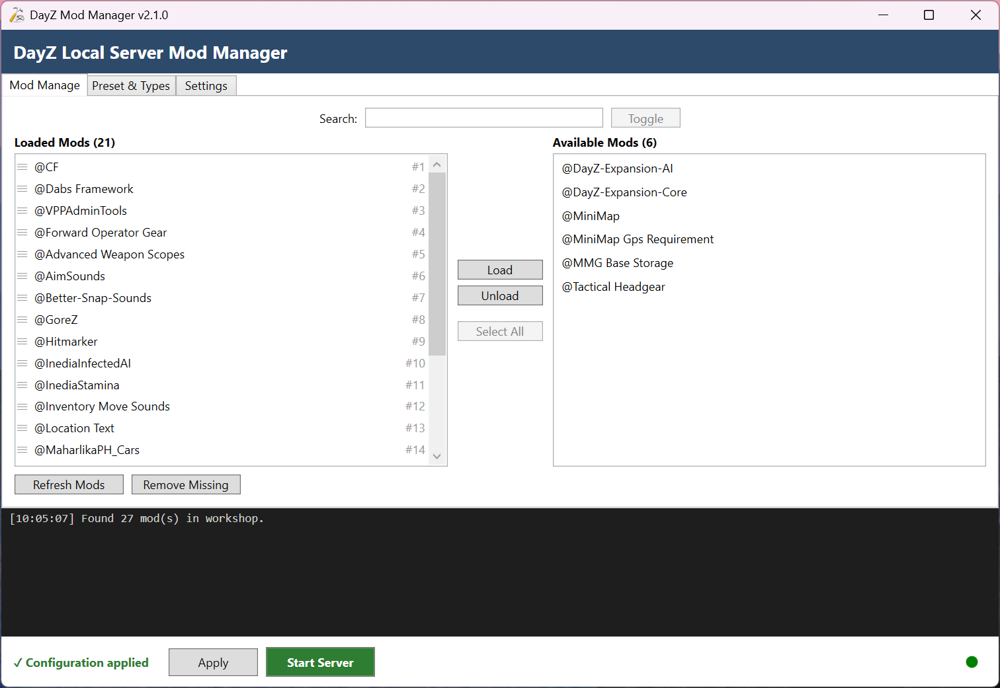
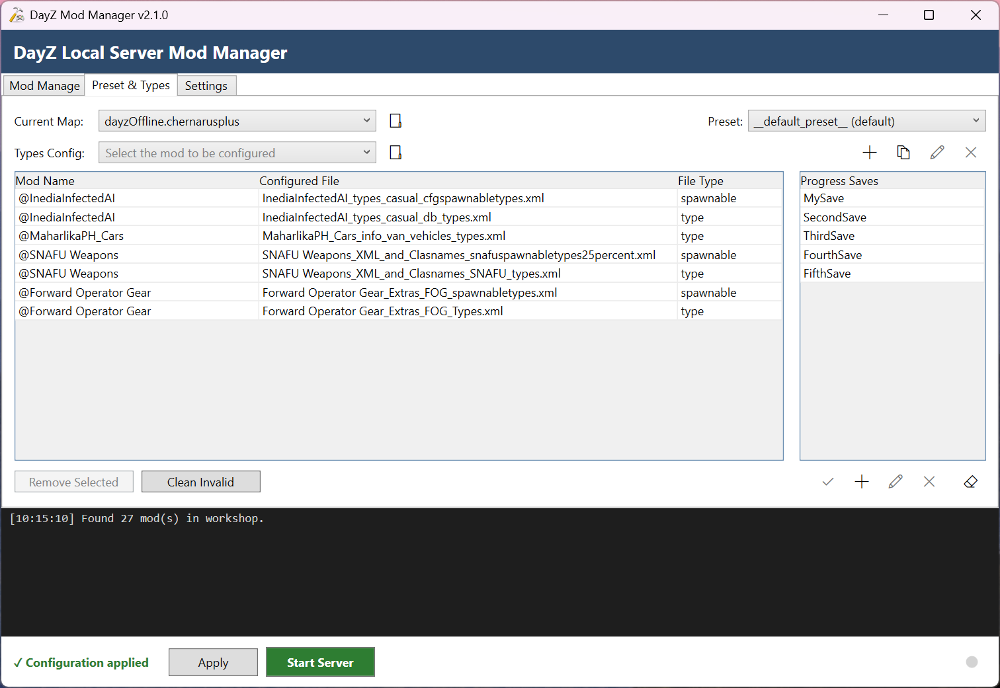

---

## ⬇️ Download

### [Download DayZ Local Server Mod Manager V2](https://github.com/RichardVincent1324/DayZ-Local-Server-Mod-Manager-V2/releases/latest)

**Latest stable release: v2.1.0**

* Windows x64
* Self-contained
* No separate .NET runtime installation required
* Single executable

> V2 manages an existing DayZ Server installation. It does **not** install or replace DayZ Server itself.

---

## What does V2 do?

Managing a heavily modded DayZ local server usually means repeatedly dealing with Workshop folders, load order, junctions, batch-file parameters, mission files, XML configuration, map profiles, and save data.

V2 puts that workflow into one Windows application so you can spend less time editing files by hand and more time playing.

---

# Getting Started

## 1. Install DayZ and DayZ Server

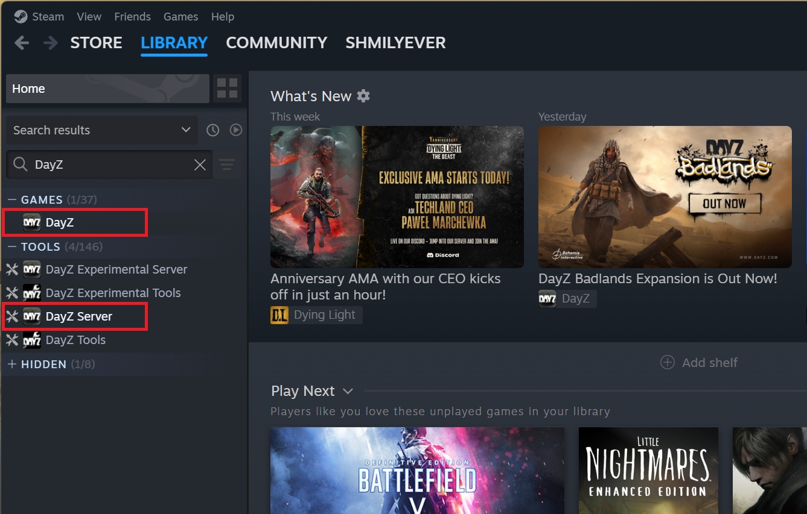

Make sure you already have:

- DayZ installed.
- DayZ Server installed (via Steam).
- Your DayZ Server folder available locally.

Make sure your DayZ Server folder contains its normal files, including `serverDZ.cfg` and the `mpmissions` directory.  If these files are missing, restore them (for example, in Steam: **DayZ Server → Properties → Installed Files → Verify integrity of game files**).

## 2. Download V2

Download the latest release:

**https://github.com/RichardVincent1324/DayZ-Local-Server-Mod-Manager-V2/releases/latest**


## 3. Download the required launch batch file

The V2 repository does **not** currently provide `LocalServer.example.bat`. Get it from the original project:

**https://github.com/RichardVincent1324/DayZ-Local-Server-Mod-Manager/blob/main/LocalServer.example.bat**

It's recommended to place both the downloaded executable and batch file in your DayZ Server root. For example:

```text
D:\...\DayZServer\DayZModManagerV2-v2.1.x-win-x64.exe
D:\...\DayZServer\LocalServer.example.bat
```

Open LocalServer.example.bat and change this line `serverDirectory` to your actual DayZ Server folder:

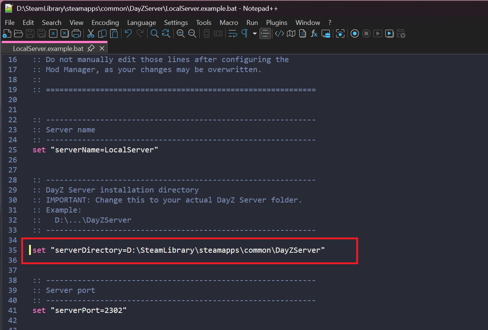

To find the actual DayZ Server Folder: in Steam: **DayZ Server → Manage → Browse Local Files**

The template contains variables V2 expects to work with, including settings similar to:

```bat
set "serverDirectory=C:\Path\To\DayZServer"
set "modList=-mod=;"
set "serverConfig=DayZ-Mod-Manager-V2\...\serverDZ.cfg"
set "serverProfile=DayZ-Mod-Manager-V2\...\profiles"
```

At minimum, change `serverDirectory` to your actual DayZ Server installation path. You can also adjust the server port, CPU count and other launch settings in the template if required.

The template must contain all three manager-owned lines: `set "modList=-mod=...`, `set "serverProfile=...` and `set "serverConfig=...`. V2 rewrites them on every Apply to point at the active preset. If any of them is missing, Apply, map/preset switching and Start Server are blocked with an error.

> [!WARNING]
> After V2 is configured to use the batch file, do not manually maintain the `modList` block. V2 owns and rewrites that portion when applying your mod configuration.

## 4. Configure the local server for this workflow

V2 is designed for local/solo play and does not manage DayZ `.bikey` / `.bisign` signature deployment.

For the intended local-server workflow, open `serverDZ.cfg`. The DayZ default value is:

```cfg
verifySignatures = 2;   // Verifies .pbos against .bisign files. (only 2 is supported)
```

Locate this existing line and change the value from `2` to `0`. Do not insert a duplicate entry.

```cfg
verifySignatures = 0;
```

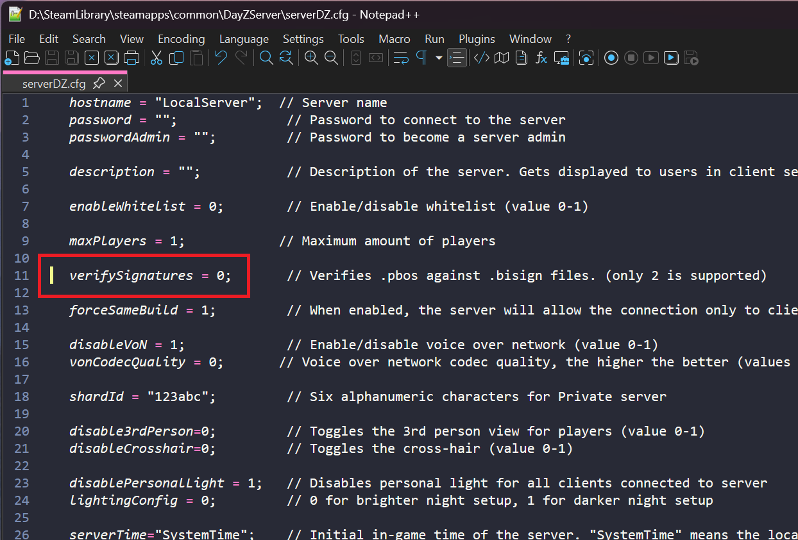

`verifySignatures = 0` disables PBO signature verification, which is required for this local-mod workflow.

> [!IMPORTANT]
> Each preset gets its own `serverDZ.cfg`, seeded by copying an existing config. Set `verifySignatures = 0` in the server-root `serverDZ.cfg` **before creating any presets** (including the default presets), or edit the active preset's `serverDZ.cfg` for presets that already exist. Changing only the server-root `serverDZ.cfg` later does not update existing presets.

> [!CAUTION]
> This setup is intended for a private local server. Do not use V2 as a public-server security or signature-management solution.

## 5. Configure V2 Settings

Open V2 and configure:

- **Workshop path** — the directory containing your installed `@...` mod folders:

  Valid examples:

  ```text
  1. <SteamLibrary>\steamapps\common\DayZ\!Workshop  → valid (recognized by name).

  2. ...\DayZ (with a !Workshop child)               → resolves to !Workshop →
                                                                              valid.

  3. ...\DayZ (no !Workshop) or an empty !Workshop   → valid by name, but discovery
                                                       warns if it finds 0 mods.

  4. D:\CustomModFolder directly containing @mod     → valid (recognized by content).
  ```

  Rejected examples:

  ```text
  1. ...\steamapps\common
     (its @mod folders are one level deeper)          → rejected.

  2. An unrelated folder with no direct @mod folder    → rejected.
  ```

- **Server path** — the directory containing `DayZServer_x64.exe` and `serverDZ.cfg`.
- **Batch file** — the `LocalServer.example.bat` file you prepared in the previous step. Select it manually on first run; V2 does not preselect a default batch file, and the server cannot be started until one is chosen.


## 6. ✅ Setup complete :tada: :confetti_ball:

> Your local DayZ server environment is ready. Continue below to learn about available features.

---

## Structure Overview

DayZ-Mod-Manager-V2 manages your server environment through a hierarchical structure.

- V2 discovers **maps** from the server's `mpmissions` directory. A folder is treated as a map only when it contains `cfgeconomycore.xml`. Common examples are `dayzOffline.chernarusplus`, `dayzOffline.enoch` and `dayzOffline.sakhal`.
- Each map can contain multiple **presets**. A preset is one complete, independent server environment: its own `serverDZ.cfg`, mod order, types configuration, `type_files`, `profiles` and saves.
- Every preset is assigned a unique `instanceId`.
- DayZ uses that `instanceId` to name the preset's live world folder: `mpmissions\<mapName>\storage_<instanceId>`.
- Stored progress saves live under the preset's own `saves` folder. Each save contains a copy of the world data plus `save-meta.json`.
- Because every preset has a distinct `instanceId`, presets never share or overwrite each other's live world or stored saves.

This structure makes it safe to run multiple maps, multiple presets and multiple save slots without cross-contamination.

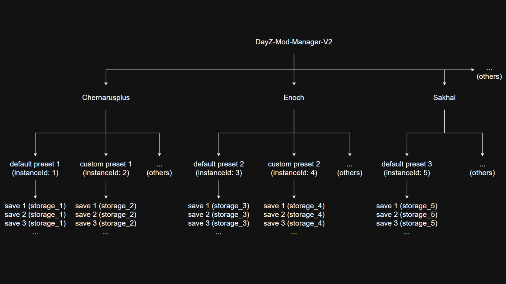

---

## Function Introduction

### 1. Drag to change the mod order

- While dragging, scroll the list with the mouse wheel.
- The `#` markers represent the mods' actual load order in the launch batch file.

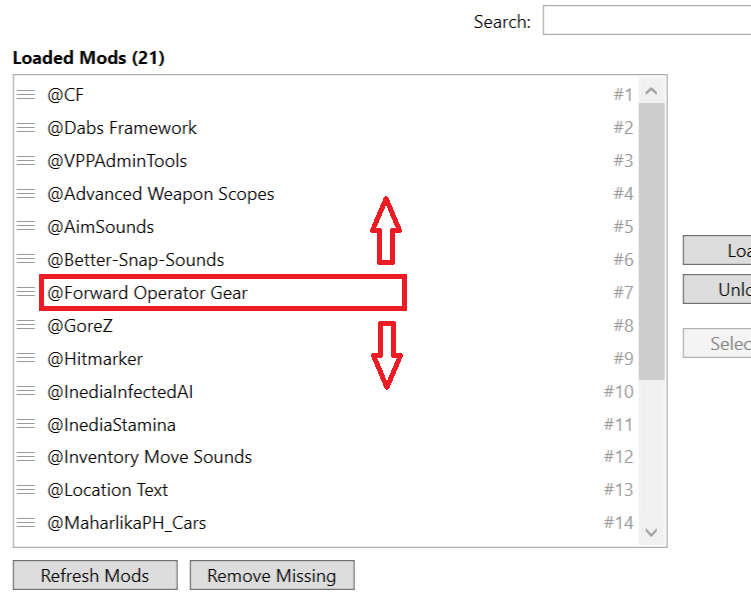

### 2. Type file selection window

- Do not blindly check every file detected.
- Avoid selecting two files that define the same type template (same template, different data). DayZ applies the later entry and it can override the earlier one.
- For unrecognized files, inspect the file before assigning a role (use the **Open Mod Folder** button). A randomly or incorrectly assigned role may prevent the server from booting.
- Once you check an unrecognized file, it is assigned the **Types** role by default. If it is actually a Spawnable Types file, expand the dropdown and choose **Spawnable**.

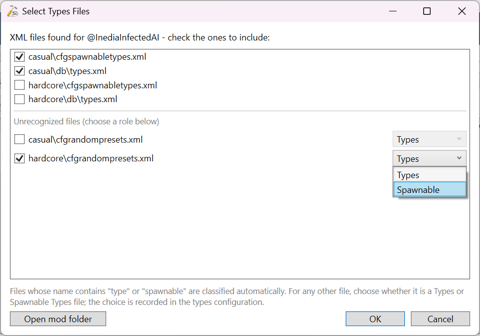
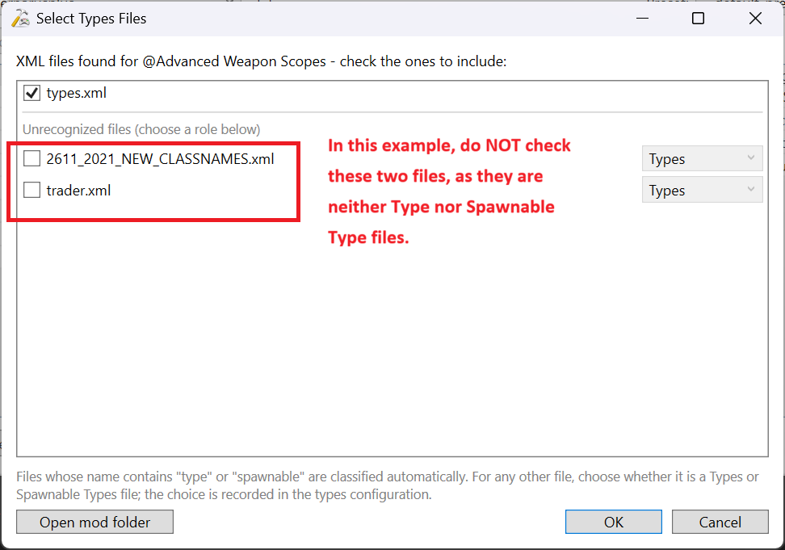

### 3. The two folder icons open frequently edited folders

- The icon beside **Current Map** opens the current preset's `profiles` folder, where you can modify mod configuration such as VppAdminTools.
- The icon beside **Types Config** opens the current preset's `type_files` folder, which holds the type files configured for the current preset. These template files are provided by mod authors and copied from the Workshop; you can edit them if needed.

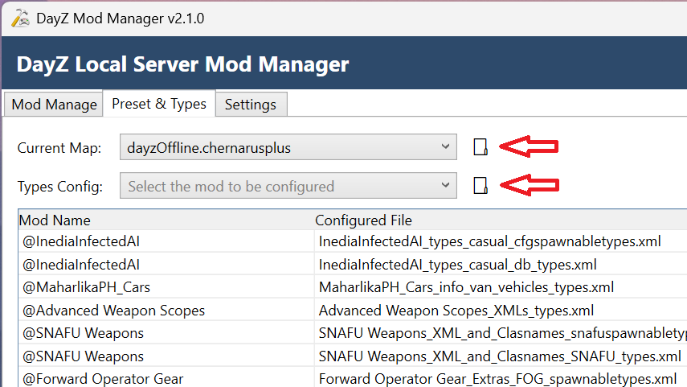

### 4. Modify each preset's independent world configuration

- Open either folder from the **Preset & Types** tab, then go up one level to the preset folder.
- `serverDZ.cfg` is stored in that preset folder. Edit its settings as needed.

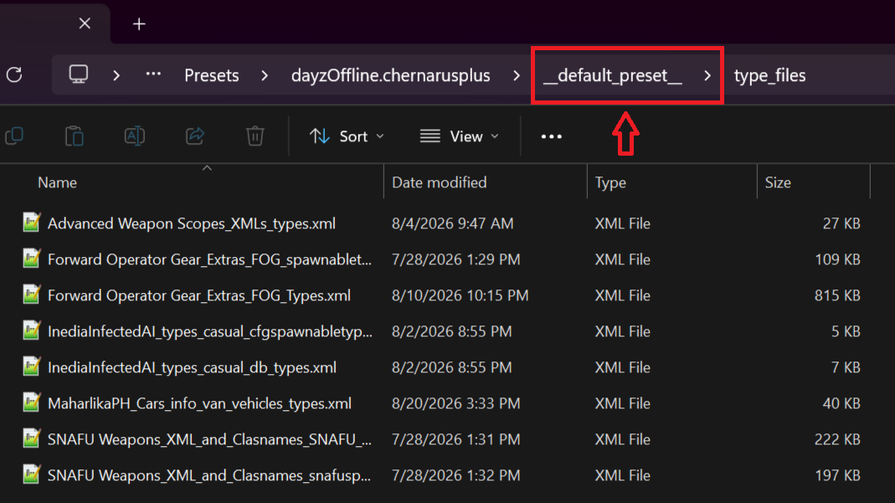
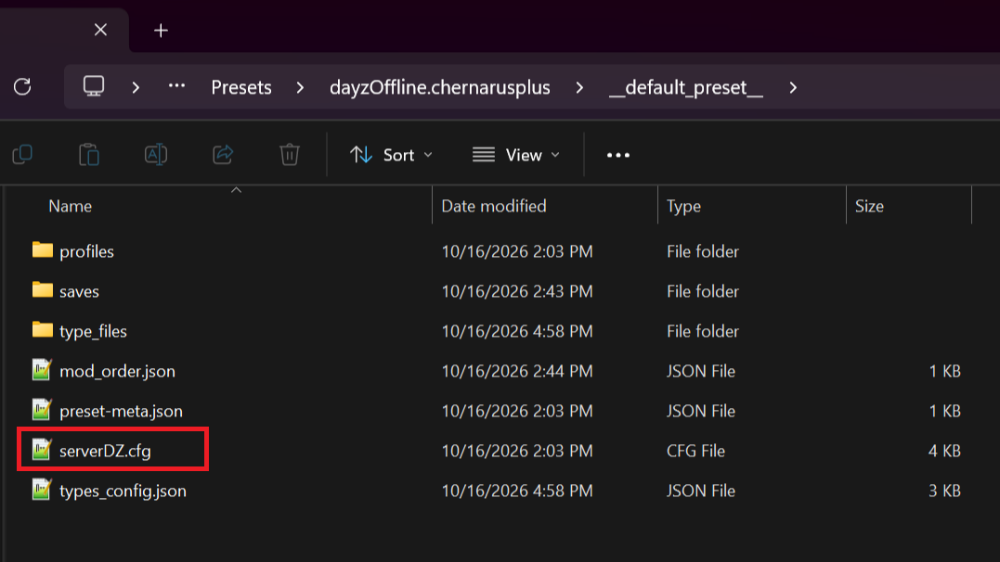

> [!WARNING]
> Do NOT alter the line **`instanceId = N;`**. It is fixed by the preset's `instanceId` stored in `preset-meta.json`; changing it points the server at a different `storage_<id>` and makes the preset fall out of sync.

### 5. Multi-select type files

- Click and drag to select multiple type files, or press `Ctrl+A` to select all.

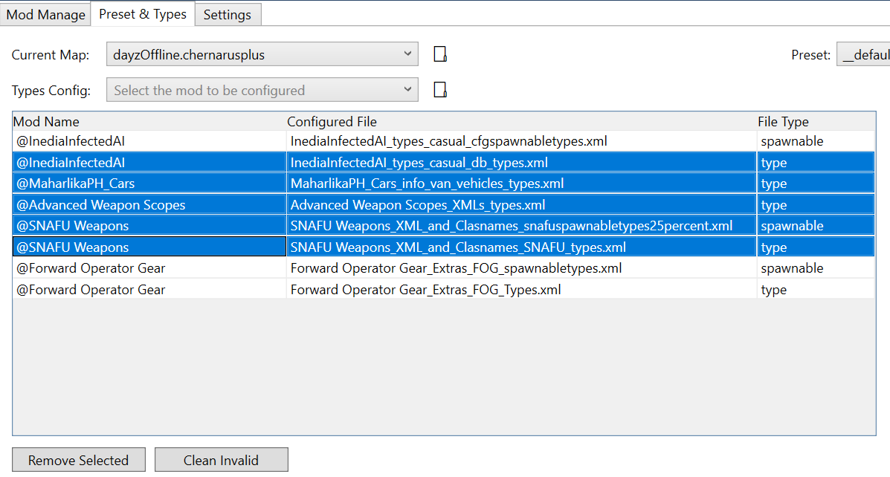

### 6. Live-world storage indicator

A small circular indicator in the bottom-right corner of the main window stays visible across all tabs and shows whether the active preset has a live world.


- **Green** — the active preset's live storage folder `mpmissions\<currentMapName>\storage_<instanceId>` exists on disk. Its tooltip shows the associated folder.
- **Light gray** — the folder does not exist. Its tooltip shows the expected `storage_<instanceId>` folder.
- The indicator checks only the active preset's own storage folder. Orphaned `storage_<id>` folders shown in **Progress Saves** never affect it.
- It updates automatically when switching presets or maps, applying configuration, or performing save / wipe world actions.

### 7. Important limitation: Partial mod‑configuration isolation

Although presets provide isolation for most server state including `profiles`, `type_files`, mod junctions, preset‑specific `serverDZ.cfg`, and per‑preset world storage, **V2 cannot deliver 100 % full environment isolation for every possible mod**.

Some mods write runtime‑generated configuration or data to folders **outside the preset‑owned `profiles` directory**.
A common example is `DayZ‑Expansion‑AI`, which maintains a separate set of configuration files here:
```
mpmissions\<mapName>\expansion
```
Files stored in such locations live outside V2’s preset‑managed scope. They are **not copied, swapped, or isolated when you switch between presets**.

All presets for the same map will share these external mod files; edits to those files will affect every preset on that map.

This is intentional: automatically handling arbitrary mod‑specific external directories would introduce very high complexity, and this tool **does not aim to implement full complete mod‑environment isolation**.

Mods that keep all their configuration entirely within the `profiles` folder work fully isolated as expected.
If you use mods that write data outside `profiles`, you need to manually back‑up, manage or swap those external folders when using multiple presets on one map.

---

## Features

### Mod management

- Discover installed DayZ mods from the configured Workshop or custom directory.
- Separate mods into **Loaded** and **Available** lists.
- Search your installed mods from the same interface.
- Load or unload mods quickly, including from search results.
- Reorder the active load order with drag-and-drop.
- Remove missing mods that are no longer present on disk.
- A mod that is loaded but no longer present on disk is shown as missing.
- Apply the selected configuration to the local server.

### Junction and batch-file management

- Loaded mods are exposed to the server as Windows directory junctions inside a per-preset subfolder of the `ModList` folder (for example `ModList\1\@CF`, keyed by the preset's `instanceId`), so switching presets never recreates or deletes another preset's junctions.
- Uses server-root-relative mod paths such as `ModList/1/@CF`.
- Rewrites the batch file's manager-owned `modList` block when applying changes.
- Writes large mod lists across multiple valid `cmd` lines (ten entries per line) rather than one unmanageable command line.
- Reconciles existing managed junctions during Apply.

- Deletes a preset's junction folder when that preset is deleted.

### Preset & Types

- Discover maps from the server's `mpmissions` directory (mission folders that contain `cfgeconomycore.xml`).
- Switch the active map via the dropdown list.
- Update the active mission `template` (DayZ uses the keyword `template` to store the map name) in the active preset's `serverDZ.cfg`.
- 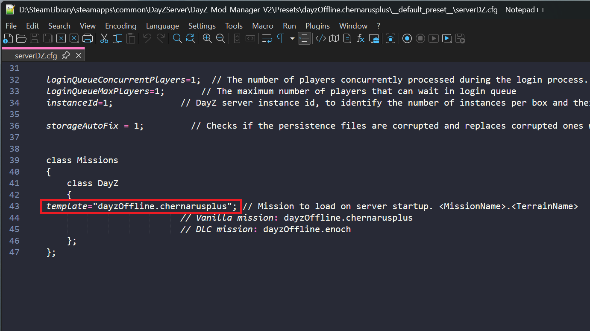
- Update the batch file's `serverProfile` and `serverConfig` lines to point at the active preset's `profiles` folder and `serverDZ.cfg`.
- Discover **every** XML file in a mod, recursively.
- Files whose names contain `type` or `spawnable` are **recognized** and classified automatically. All other files are listed separately at the bottom of the picker, where you assign each one a **Types** or **Spawnable** role.
- Use the picker's **Open Mod Folder** button to inspect a mod's XML files in File Explorer before assigning roles.
- Copy the selected files from the Workshop into the active preset's `type_files` folder.
- Store each file's role in `types_config.json`; the role drives the `type` attribute and, within each mod, the types-before-spawnabletypes ordering in `cfgeconomycore.xml`.
- The types grid shows **Mod Name**, **Configured File** and **File Type** (`type` or `spawnable`), so the assigned role is visible at a glance.
- Keep `cfgeconomycore.xml` synchronized with manager-owned types entries.
- Own its `<ce>` block outright: V2 marks the block it manages with `dzmmv2-managed-by="DayZ-Mod-Manager-V2"` and fully rewrites that block's `<file>` entries (and its `folder` attribute) whenever it syncs the economy (Apply, map switch, preset switch and types edits). The `<ce>` element and its marker are always kept, even when the block becomes empty.
- 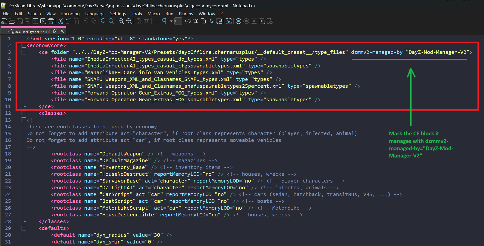
- Leave every other `<ce>` block untouched, including legacy V2's `./db/ModTypes` block and blocks written by other tools. Entries V2 does not own are never modified.
- Surface untracked XML files in `type_files` (present on disk but absent from `types_config.json`) as `(untracked)` rows, so leftovers from manual edits, failed deletes or an earlier version stay visible and can be removed. V2's managed `<ce>` block references only tracked files, so an untracked file is not loaded unless another `<ce>` block also lists it.
- Ask for confirmation before overwriting or deleting configured types files.
- Support `Remove Selected` and `Clean Invalid` maintenance operations.
- Warn before types edits when the preset already has a saved world (or a live world), because DayZ only reads these files when a new world is created; edits only affect future spawns and newly created saves.
- Open the active preset's `type_files` folder, or its `profiles` folder, directly in File Explorer from the buttons beside **Types Config** and **Current Map**.

> **Upgrading from an older V2 release:** the `<ce>` block written by older versions has no marker, so V2 cannot tell it apart from a block it is expected to leave alone. It is treated as unmanaged: V2 leaves it in place and creates a new marked block alongside it. DayZ loads the `<file>` entries of every `<ce>` block, so the old block's entries may be duplicated until you remove it manually. Remove any unmarked `<ce>` block that references the V2 `type_files` folder; V2 logs a warning when it detects one. There is no automatic migration.

### Presets and progress saves

V2 is **preset-driven**: a *preset* is one complete, independent DayZ server environment (server configuration, mod order, types configuration, `type_files`, profiles and a dedicated instance ID). A *save* is only a point-in-time snapshot of the world belonging to a preset.

- Each map has an automatically created `__default_preset__` that cannot be renamed or deleted. It is created when that map is first applied — which can happen automatically on the first run for the first discovered map (once the server path and batch file are set) or when you select the map. It is not created for every discovered map.
- Add a named preset with **[Add Preset]**; it starts with an empty `profiles` folder. Presets never share profile data.
- Duplicate the current preset to copy its server configuration, mod order, types configuration and generated type files; **profiles and saves are never copied**. The copy may target a different map, in which case map-scoped settings are rewritten.
- Preset names may contain only letters, digits, `.`, `_`, `-` and `+` — **no spaces** — and may not end with a dot or be a reserved Windows device name. The launch batch passes the active preset's `serverDZ.cfg` / `profiles` path to the server unquoted (`-config=%serverConfig%`, `-profiles=%serverProfile%`), and the DayZ Server does not accept a quoted `-config` value, so a space in the preset name would prevent the server from starting.
- A preset's `serverDZ.cfg` is seeded by copying an existing config and rewriting only its `template` (the map) and `instanceId`:
  - a duplicated preset copies its source preset's `serverDZ.cfg`; if that file is missing, duplicating fails;
  - a named preset copies its map's `__default_preset__\serverDZ.cfg`; if that file is missing, adding the preset fails;
  - `__default_preset__` copies `<serverPath>\serverDZ.cfg`. If the root config has a valid `instanceId` that **no preset uses yet**, the default preset adopts that id, which attaches the map's existing `storage_<id>` world when it exists. If the id is already used by another preset, V2 allocates a fresh id, logs a warning, and does not attach that world. Because instance IDs key the shared `ModList` folder, only one preset can use the root id.
- `serverDZ.cfg` must exist. It ships with the DayZ Server installation and is **not** generated by the server; if it is missing, restore it (Steam → Verify integrity of game files) or copy a valid file there. V2 refuses to create the preset rather than fabricating a configuration.
- V2 only **reads** the server-root config; it never overwrites it. A batch file missing the `serverConfig` line is rejected instead (see [Required batch-file notes](#required-batch-file-notes)).
- Seeding only happens when a preset is first created. If an existing preset's `serverDZ.cfg` is later deleted, V2 does **not** re-seed it; it reports the missing file and leaves the preset unusable until you restore it. A missing `preset-meta.json` is rebuilt automatically **only for `__default_preset__`**, preserving its `instanceId`; a named preset missing its metadata is reported as incomplete. To recreate the default preset, delete its `__default_preset__` folder; V2 regenerates it on the next map apply.
- All presets of a map coexist independently, each with its own `instanceId`, so switching presets never overwrites another preset's live world (`storage_<instanceId>`).
- Save the current world progress for the active preset (a copy of `storage_<instanceId>` plus `save-meta.json`). **Add Save requires the live storage folder to exist**, so run the server at least once first.
- Loading a save restores only the world state; the preset's mods, types and profiles are unchanged.
- Wipe the world to delete the preset's live storage folder so the map starts fresh on the next launch.
- The save list also shows live `storage_<id>` folders that no preset owns as `(orphaned)`; these may come from a deleted preset or from before V2 managed the server, and can be deleted from the list.
- Deleting a preset removes its folder (configuration, profiles and stored saves) and its `ModList` junction folder, but **does not delete its live world** `storage_<instanceId>`; that world then appears as `(orphaned)` storage and can be deleted separately.
- Save / Load / Wipe / Rename Save, and preset switch / rename / delete, are blocked while the DayZ Server process is running.
- Loading a save replaces the live storage folder with the save's copy.

> **Existing worlds:** V2 can automatically attach only the world matching the server-root `instanceId`, and only to the first default preset created while that id is free. It cannot attach arbitrary `storage_<id>` folders to other presets. Unattached worlds appear as `(orphaned)` in the save list and can be deleted.

### Settings and data storage

V2 keeps its configuration and save data in a dedicated data directory.

Before a server path is configured:

```text
%LOCALAPPDATA%\DayZ-Mod-Manager-V2
```

After a server path is configured:

```text
<serverPath>\DayZ-Mod-Manager-V2
```

Changing the server path relocates the data files to the new location after a successful Apply. A pointer file in `%LOCALAPPDATA%` remembers the active data directory between launches.

Typical contents include:

```text
DayZ-Mod-Manager-V2\
├─ settings.json
└─ Presets\
   └─ <mapName>\
      ├─ __default_preset__\
      │  ├─ preset-meta.json
      │  ├─ serverDZ.cfg
      │  ├─ mod_order.json
      │  ├─ types_config.json
      │  ├─ type_files\
      │  ├─ profiles\
      │  └─ saves\
      │     └─ <saveName>\
      │        ├─ save-meta.json
      │        └─ storage_<id>\
      └─ <userPreset>\
         └─ (same structure)
```

Each preset's `instanceId` is stored in `preset-meta.json` (with `serverDZ.cfg` as a fallback) and identifies its runtime storage slot at `mpmissions\<mapName>\storage_<instanceId>`.

The Settings tab also has **Auto-clean server log files on startup**. When enabled, and when more than 20 combined `.rpt` / `.log` files have accumulated in the active preset's `profiles` folder, V2 deletes all of them on startup. At or below 20 no files are touched. Default: **off**.

Always stop the DayZ server before performing operations that alter the active world state: switching maps or presets, modifying types configs, loading saves or wiping the world.

---

## Upgrading from an earlier version

> [!IMPORTANT]
> Version **v2.1.0** includes a core architectural refactor, and its file structure is no longer compatible with older V2 releases. A clean setup is strongly recommended. Back up anything you want to keep before proceeding.

To remove an old V2 installation:

1. Launch the old V2 build of DayZ Mod Manager.
2. Unload all mods via the **Mod Manage** tab, then remove all configured types files using the **[Remove Selected]** button in the **Preset & Types** tab.
3. Close the application and delete the old executable.
4. Delete the `DayZServer\DayZ-Mod-Manager-V2`, `ModList` and `%LOCALAPPDATA%\DayZ-Mod-Manager-V2` directories.


Deleting the `ModList` folder removes junctions, not the Workshop mods they point to. Make sure you delete the junction folder itself rather than deleting through a junction.

Older or custom batch templates must contain all three `set` lines (`modList`, `serverProfile`, `serverConfig`). V2 no longer falls back to copying the preset config over the server-root `serverDZ.cfg`; a template missing any line is rejected.

---

## Required batch-file notes

The downloaded `LocalServer.example.bat` is not just a convenience sample. It provides the launch structure V2 is designed to manage.

The template includes, among other settings:

- `serverDirectory` — location of the DayZ Server installation.
- `modList` — **required**; V2 rewrites it after setup.
- `serverProfile` — **required**; the active preset's profiles directory (written by V2 on Apply).
- `serverConfig` — **required**; the active preset's `serverDZ.cfg` path (written by V2 on Apply; the template's initial value is only a placeholder).

The template also starts `DayZServer_x64.exe` (and can launch the DayZ client through Steam). The exact batch filename does not matter; V2 uses the file you select in Settings.

All three lines (`modList`, `serverProfile`, `serverConfig`) are required. If any is missing, V2 blocks Apply, map/preset switching and Start Server with an error; it never copies the preset's `serverDZ.cfg` over the server-root file as a fallback.

**If you skip the batch-file setup, V2 will not have the expected launcher file to update and start, so the normal Apply / map-profile / server-launch workflow will not work as intended.**

---

## Important: local servers/solo play only

V2 is intentionally focused on local DayZ environments, solo play and single-player PvE.

It does **not** provide a complete public-server administration stack and does not manage:

- `.bikey` deployment.
- `.bisign` files.
- Server-side signature verification workflows.
- Remote/headless server administration.

If you are running a public or shared dedicated server that requires proper signature verification and key management, use tooling designed for that use case.

---

## Server and file layout

A configured server may look similar to this:

```text
<serverPath>\
├─ DayZ-Mod-Manager-V2\
│  ├─ settings.json
│  └─ Presets\
│     └─ <mapName>\
│        └─ <presetName>\
│           ├─ preset-meta.json
│           ├─ serverDZ.cfg
│           ├─ mod_order.json
│           ├─ types_config.json
│           ├─ type_files\
│           ├─ profiles\
│           └─ saves\
├─ LocalServer.bat
├─ ModList\
│  ├─ 1\                    -> junction folder for preset with instanceId 1
│  │  ├─ @CF                -> junction to Workshop mod
│  │  └─ @AnotherMod        -> junction to Workshop mod
│  └─ 2\                    -> junction folder for another preset
│     └─ ...
├─ mpmissions\
│  └─ <mapName>\
│     ├─ cfgeconomycore.xml
│     └─ storage_<instanceId>\
└─ DayZServer_x64.exe
```

The launch batch file's `modList`, `serverProfile` and `serverConfig` lines are pointed at the active preset (its `profiles` and `serverDZ.cfg`), and the marked `<ce>` block in `cfgeconomycore.xml` references the active preset's `type_files` folder.

---

## Safety behavior

V2 is designed to reduce accidental damage to your local server setup:

- Apply validates the environment before committing the configuration.
- Junction preparation happens before destructive cleanup.
- A failed batch-file write does not remove junctions still referenced by the existing launcher configuration.
- A failed save/load copy reports an error. Note that loading a save deletes the live world before copying the stored one, so a failure partway through can leave the live world partially restored — keep backups of important worlds.
- Save / Load / Wipe World operations (and preset switch / rename / delete) are blocked while the DayZ Server process is running.
- Types configuration asks before overwriting or deleting managed files.
- Starting the server is blocked when loaded mods are missing or when referenced type files are absent.
- Apply, map/preset switching and Start Server are blocked when the launch batch file is missing any manager-owned line (`modList`, `serverProfile`, `serverConfig`).
- Manager-owned changes are limited to the lines and files V2 is responsible for. V2 only reads the server-root `serverDZ.cfg`; it never writes it.

Even so, keeping your own backup of important server configuration and save data is always recommended before major changes.

---

## Requirements

### For users

- 64-bit Windows.
- DayZ Standalone.
- A working local DayZ Server installation.
- Installed Workshop mods if you intend to use mods.
- A compatible launch `.bat` file — **download `LocalServer.example.bat` from the original repository as described above**.

### For developers

- Windows.
- [.NET 8 SDK](https://dotnet.microsoft.com/download/dotnet/8.0).
- Visual Studio 2022 or another .NET 8 / WPF-capable development environment.

---

## Build from source

Clone the repository:

```powershell
git clone https://github.com/RichardVincent1324/DayZ-Local-Server-Mod-Manager-V2.git
cd DayZ-Local-Server-Mod-Manager-V2
```

Build:

```powershell
dotnet build DayZModManagerV2.sln
```

Run the application:

```powershell
dotnet run --project src/DayZModManager.App
```

Run tests:

```powershell
dotnet test DayZModManagerV2.sln
```

### Publish a self-contained Windows x64 build

```powershell
dotnet publish src/DayZModManager.App `
  -c Release `
  -r win-x64 `
  --self-contained true `
  -p:PublishSingleFile=true `
  -p:IncludeNativeLibrariesForSelfExtract=true `
  -p:EnableCompressionInSingleFile=true `
  -p:DebugType=None `
  -p:DebugSymbols=false
```

---

## Project structure

```text
src/
├─ DayZModManager.Core/       # domain logic and services
└─ DayZModManager.App/        # WPF UI / MVVM application

tests/
├─ DayZModManager.Core.Tests/
└─ DayZModManager.App.Tests/
```

V2 separates its core server/mod-management logic from the WPF UI to make the application easier to maintain and test.

---

## V1 → V2

V2 is a full rewrite rather than only a visual refresh.

| V1 | V2 |
| --- | --- |
| PowerShell | C# / .NET 8 |
| PowerShell GUI | WPF / MVVM |
| Script-oriented architecture | Structured application architecture |
| Root-level mod junction workflow | Dedicated `ModList` junction folder |
| Basic mod/types workflow | Integrated map, types, untracked-file and safety handling |
| Lack of save management | Named progress saves with metadata and world snapshots |
| Limited testability | Dedicated Core/App test projects |

The original repository remains important because it currently hosts the required `LocalServer.example.bat` template used to prepare V2's launch workflow.

---

## Troubleshooting

### V2 cannot find or update my batch file

Confirm that you downloaded the batch template from the original repository, placed a copy in your DayZ Server folder, and selected that file in V2 Settings. The batch file must contain all three manager-owned lines: `set "modList=-mod=...`, `set "serverProfile=...` and `set "serverConfig=...`. If any is missing, Apply and Start Server are blocked with an error.

**Template:**
https://github.com/RichardVincent1324/DayZ-Local-Server-Mod-Manager/blob/main/LocalServer.example.bat

### The server does not start

Try running your prepared batch file manually. Verify that:

- `serverDirectory` points to the correct folder.
- `DayZServer_x64.exe` exists in that folder.
- `serverDZ.cfg` exists in the server root **and** in the active preset folder.
- Your port and other launch settings are valid.
- `verifySignatures = 0;` is set in the **active preset's** `serverDZ.cfg` (or was set in the server-root config before the preset was created).
- Start Server reports no missing mods or missing type files.

### Mods do not load correctly

Check that:

- The Workshop path points to the folder containing your `@...` mods.
- The desired mods are in the Loaded list.
- Apply completed successfully.
- The generated `ModList\<instanceId>` junctions exist.
- The selected batch file contains the V2-managed mod list.
- `verifySignatures = 0;` is configured for the intended local/solo workflow.

### Custom items do not spawn

Check the **Preset & Types** configuration and confirm that the required XML files are present in the active preset's `type_files` folder and referenced by `cfgeconomycore.xml`.

Also note that types edits do not retroactively change items already spawned in an existing world. To see the effect, wipe the world or start from a new save.

### Add Save reports that no storage folder exists

Start the server once and let it create the world, then save. `Add Save` copies the live `storage_<instanceId>` folder, so it must exist first.

### Save / Load / Wipe World is unavailable

Stop the DayZ Server process first. V2 intentionally refuses world-changing save and preset operations while the server is running.

### A preset is missing or incomplete

V2 reports which part is missing (folder, `preset-meta.json` or `serverDZ.cfg`). For `__default_preset__`, delete its folder and V2 regenerates it on the next map apply. For a named preset, restore the missing file or delete and recreate the preset. A deleted preset's live world remains as `(orphaned)` storage and can be deleted from the save list.

---

## Contributing

Bug reports, suggestions and improvements are welcome.

When reporting a problem, please include:

- What you were trying to do.
- What you expected to happen.
- What actually happened.
- Relevant error messages or screenshots.
- Your DayZ/server configuration when appropriate.

Issues and pull requests can be submitted through this repository.

---

## License

This project is licensed under the [MIT License](LICENSE).

---

## Disclaimer

This project is an independent community tool.

**DayZ** is a trademark of Bohemia Interactive. This project is not affiliated with or endorsed by Bohemia Interactive.

---

## Links

- [Download the latest V2 release](https://github.com/RichardVincent1324/DayZ-Local-Server-Mod-Manager-V2/releases/latest)
- [V2 repository](https://github.com/RichardVincent1324/DayZ-Local-Server-Mod-Manager-V2)
- [Original V1 repository](https://github.com/RichardVincent1324/DayZ-Local-Server-Mod-Manager)
- [Required `LocalServer.example.bat` template](https://github.com/RichardVincent1324/DayZ-Local-Server-Mod-Manager/blob/main/LocalServer.example.bat)
