[English](./README.md) | **简体中文**

# DayZ Local Server Mod Manager V2

> **一款 Windows 桌面应用，让使用大量模组的 DayZ 本地服务器和单人 PvE 更容易搭建与管理。**

**DayZ Local Server Mod Manager V2** 将使用大量模组的 DayZ 本地服务器和单人 PvE 管理流程整合到一个图形化应用中。你可以在这里整理模组预设和加载顺序、切换地图、配置战利品经济系统与服务器启动参数，以及管理世界进度存档。

V2 是原版 [DayZ Local Server Mod Manager](https://github.com/RichardVincent1324/DayZ-Local-Server-Mod-Manager) 的继任版本，使用 **C# / .NET 8 和 WPF** 完全重构。

---

## 截图

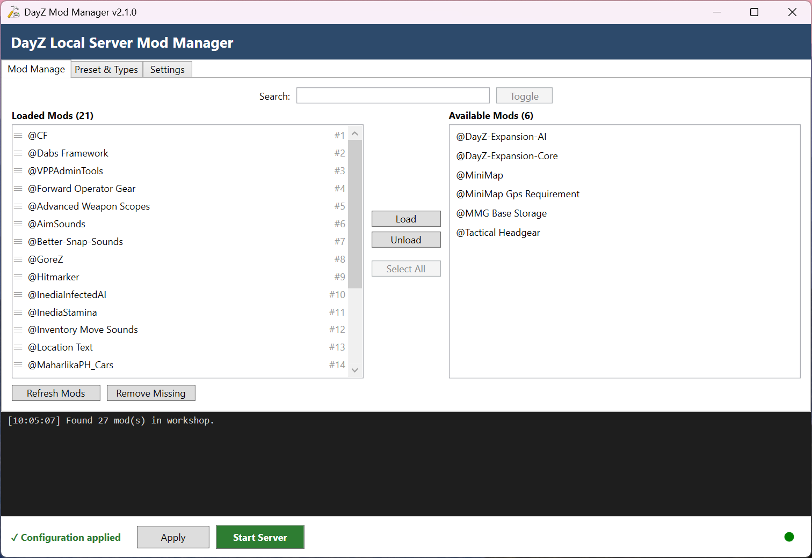 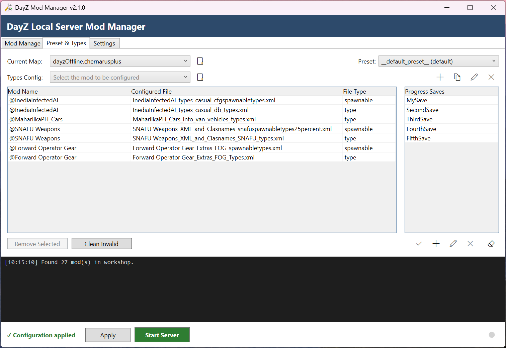

---

## ⬇️ 下载

### [下载 DayZ Local Server Mod Manager V2](https://github.com/RichardVincent1324/DayZ-Local-Server-Mod-Manager-V2/releases/latest)

**最新稳定版本：v2.1.0**

* Windows x64
* 独立运行版本（Self-contained）
* 无需单独安装 .NET 运行时
* 单个可执行文件

> V2 管理的是已安装好的 DayZ Server 文件夹。它**不会**安装或替换 DayZ Server 本身。

---

## V2 能做什么？

管理一个使用大量模组的 DayZ 本地服务器，往往意味着需要反复处理 Workshop 文件夹、加载顺序、目录联接、批处理文件参数、任务文件、XML 配置、地图配置文件以及存档数据。

V2 将这些工作流程整合进一个 Windows 应用中，让你少花时间手动编辑文件，把更多时间留给游戏。

---

## 入门指南

### 1. 安装 DayZ 和 DayZ Server

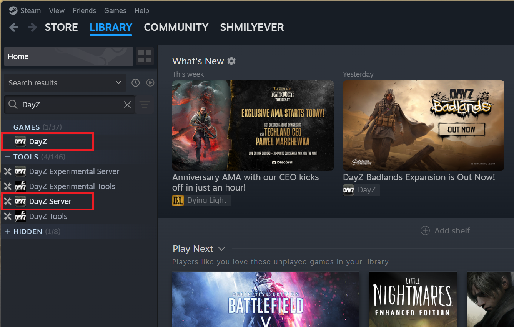

开始之前，请确保你已经：

- 安装了 DayZ。
- 已通过 Steam 安装 DayZ Server。
- 本地可以访问 DayZ Server 文件夹。

确保 DayZ Server 文件夹中包含标准文件，例如 `serverDZ.cfg` 和 `mpmissions` 目录。

### 2. 下载 V2

下载最新版本：

**https://github.com/RichardVincent1324/DayZ-Local-Server-Mod-Manager-V2/releases/latest**


### 3. 下载必需的启动批处理文件

目前，V2 仓库**不包含** `LocalServer.example.bat`。请从原项目中下载：

**https://github.com/RichardVincent1324/DayZ-Local-Server-Mod-Manager/blob/main/LocalServer.example.bat**

建议将下载的可执行文件和批处理文件都放在 DayZ Server 根目录下。例如：

```text
D:\...\DayZServer\DayZModManagerV2-v2.1.x-win-x64.exe
D:\...\DayZServer\LocalServer.example.bat
```

打开 `LocalServer.example.bat`，将 `serverDirectory` 设置为你的 DayZ Server 实际安装目录：

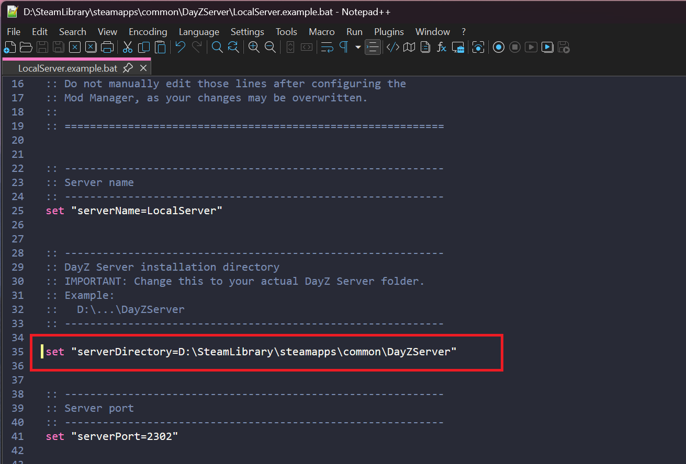

要找到你的 DayZ Server 文件夹，打开 Steam，选择 **DayZ Server → 管理 → 浏览本地文件**。

模板中定义了 V2 需要使用的变量，包括：

```bat
set "serverDirectory=C:\Path\To\DayZServer"
set "modList=-mod=;"
set "serverConfig=DayZ-Mod-Manager-V2\...\serverDZ.cfg"
set "serverProfile=DayZ-Mod-Manager-V2\...\profiles"
```

至少需要将 `serverDirectory` 设置为 DayZ Server 的安装路径。你也可以根据需要调整服务器端口、CPU 核心数和其他启动设置。

模板必须包含以下三行由管理器负责维护的配置：`set "modList=-mod=...`、`set "serverProfile=...` 和 `set "serverConfig=...`。每次点击 Apply 时，V2 都会重写这三行：`modList` 写入当前预设的模组列表，`serverProfile` 和 `serverConfig` 则指向当前预设的 `profiles` 文件夹和 `serverDZ.cfg`。

> [!WARNING]
> 在 V2 配置为使用该批处理文件后，请勿再手动编辑 `modList` 部分。应用模组配置时，这一部分由 V2 负责管理和重写。

### 4. 配置本地服务器（关闭签名验证）

V2 面向本地/单人游戏，不负责部署 DayZ 的 `.bikey` / `.bisign` 签名文件。

若要按照预期方式使用本地服务器，请打开 `serverDZ.cfg`。DayZ 的默认值为：

```cfg
verifySignatures = 2;   // Verifies .pbos against .bisign files. (only 2 is supported)
```

找到这一现有配置行，将数值从 `2` 改为 `0`。不要重复添加一条相同配置行。

```cfg
verifySignatures = 0;
```

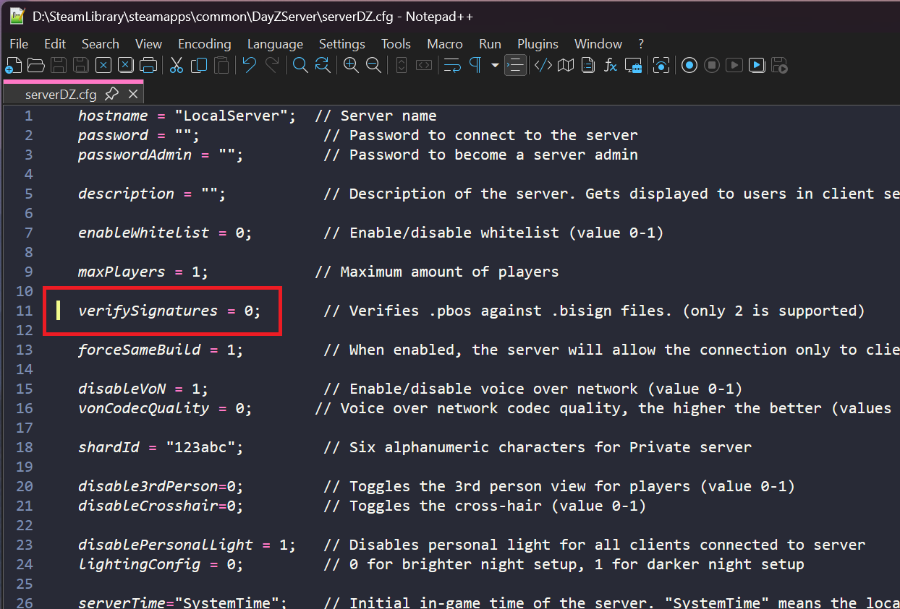

`verifySignatures = 0` 会禁用 PBO 签名验证，这是此本地模组工作流程所必需的设置。

> [!IMPORTANT]
> 请务必在创建任何预设之前完成此操作，包括 `__default_preset__`。创建预设时，V2 会复制当时的 `serverDZ.cfg`。如果预设已经创建，你之后才修改服务器根目录下的 `serverDZ.cfg`，已有预设中的副本不会随之更新。若要修正已有预设，请编辑该预设目录中的 `serverDZ.cfg`。

> [!CAUTION]
> 此配置仅适用于私人本地服务器。请勿将 V2 当作公共服务器的安全管理或签名管理工具。

### 5. 配置 V2 设置

打开 V2 并配置以下项目：

- **Workshop 路径** — 存放已安装的 `@...` 模组文件夹的目录：

  有效示例：

  ```
  1. <SteamLibrary>\steamapps\common\DayZ\!Workshop  → 有效（通过名称识别）。

  2. ...\DayZ（含 !Workshop 子文件夹）               → 解析到 !Workshop → 有效。

  3. ...\DayZ（无 !Workshop）或空的 !Workshop        → 名称判定有效，但发现
                                                    0 个模组时会发出警告。

  4. D:\CustomModFolder 直接包含 @mod                → 有效（通过内容识别）。
  ```
  无效示例：

  ```text
  1. ...\steamapps\common
     （其 @mod 文件夹在更深一层）       → 拒绝.

  2. 直接没有 @mod 文件夹的不相关目录    → 拒绝.
  ```

- **服务器路径** — 包含 `DayZServer_x64.exe` 和 `serverDZ.cfg` 的目录。
- **批处理文件** — 上一步准备好的 `LocalServer.example.bat` 文件。

> [!IMPORTANT]
> **刚从创意工坊下载的模组不会立刻出现在 `!Workshop` 中，需要 DayZ 处理一次后才会写入。**
> 在 Steam 中订阅或下载模组后，请**先启动一次 DayZ 客户端**。DayZ 会在此时把下载好的模组写入 `!Workshop`。如果你在下载完模组后立刻打开 V2，这些模组将**不会**出现在 **可用（Available）** 列表中。请关闭 V2，启动一次 DayZ，然后重新打开 V2 再查看。


### 6. ✅ 设置完成 :tada: :confetti_ball:

> 你的 DayZ 本地服务器环境现已准备就绪。继续阅读下文，来了解可用功能。

---

## 目录结构概览

V2 按照以下层级组织服务器环境：

- V2 会从服务器的 `mpmissions` 目录中发现**地图**。只有包含 `cfgeconomycore.xml` 的文件夹才会被识别为地图。常见示例包括 `dayzOffline.chernarusplus`、`dayzOffline.enoch` 和 `dayzOffline.sakhal`。
- 每张地图可以包含多个**预设**。每个预设拥有自己的 `serverDZ.cfg`、模组顺序、类型配置、`type_files`、`profiles` 和独立的实时世界存储。写入 `profiles` 之外的模组数据不会按预设隔离。
- 每个预设都会分配一个唯一的 `instanceId`。
- DayZ 使用该 `instanceId` 为预设的实时世界目录命名：`mpmissions\<mapName>\storage_<instanceId>`。
- 已保存的世界进度存档位于预设的 `saves` 文件夹中。每个存档都包含一份世界数据副本和一个 `save-meta.json` 文件。
- 由于每个预设都有独立的 `instanceId`，不同预设之间不会共享或覆盖彼此的实时世界或已保存的存档。

这种结构让你可以管理多张地图、多个预设和多个存档位，同时避免不同预设的世界数据相互干扰。

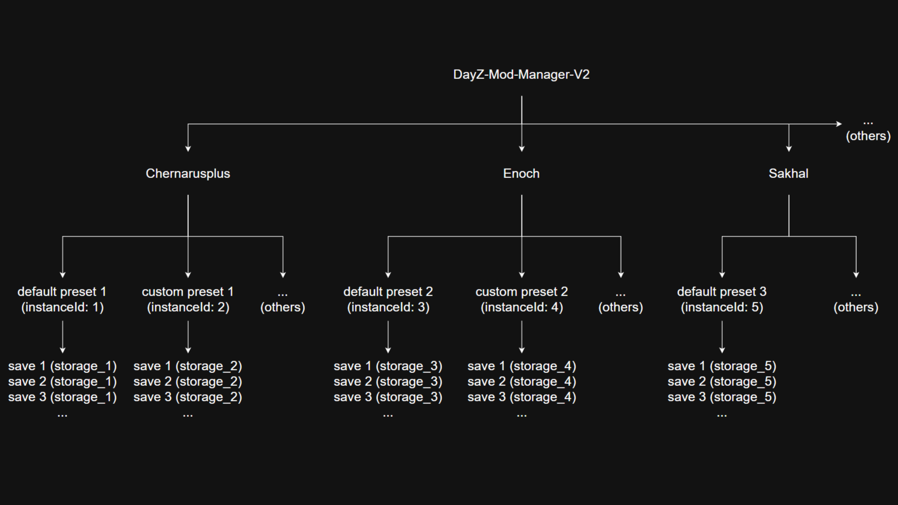

---

## 功能指南

### 1. 拖动以调整模组顺序

- 拖动时，可以使用鼠标滚轮滚动列表，也可以将鼠标悬停在列表顶部或底部边缘以自动滚动。
- `#` 标记表示模组在启动批处理文件中的实际加载顺序。

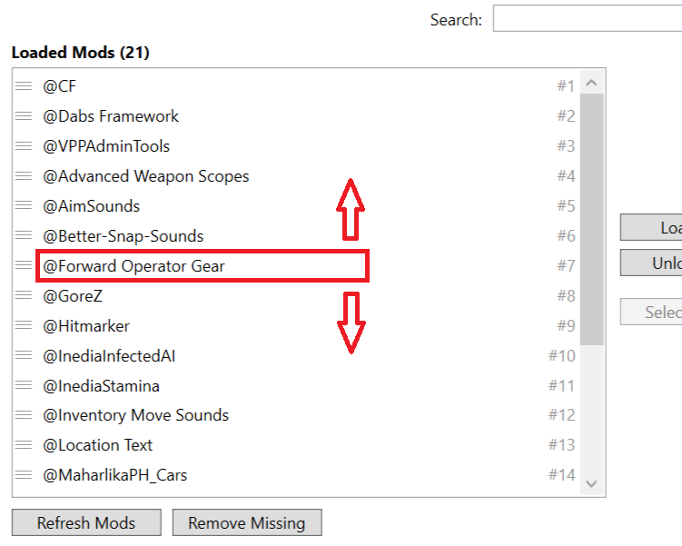

### 2. 选择类型文件

- 不要不经检查就勾选所有检测到的文件。
- 避免同时选择两个针对同一类型模板的文件（模板名相同，但数据不同）。对于同名模板，DayZ 会采用靠后的条目，因此后面的条目可能覆盖前面的条目。
- 对于无法识别的文件，先用 **打开模组文件夹（Open Mod Folder）** 按钮检查文件，再为其指定类型。指定错误的类型可能导致服务器无法启动。
- 勾选无法识别的文件时，它默认被设为 **Types** 类型。如果该文件属于 Spawnable Types 文件，展开下拉菜单并选择 **Spawnable**。

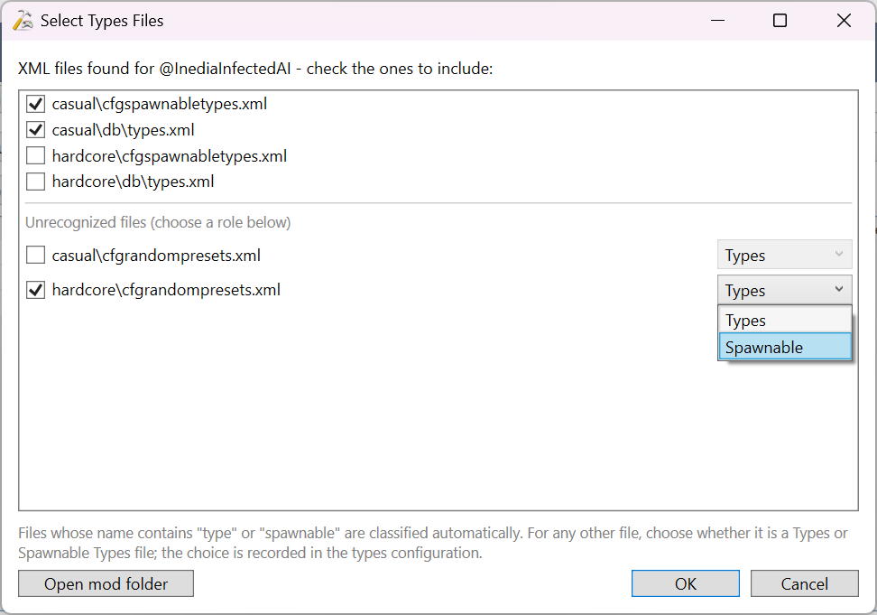 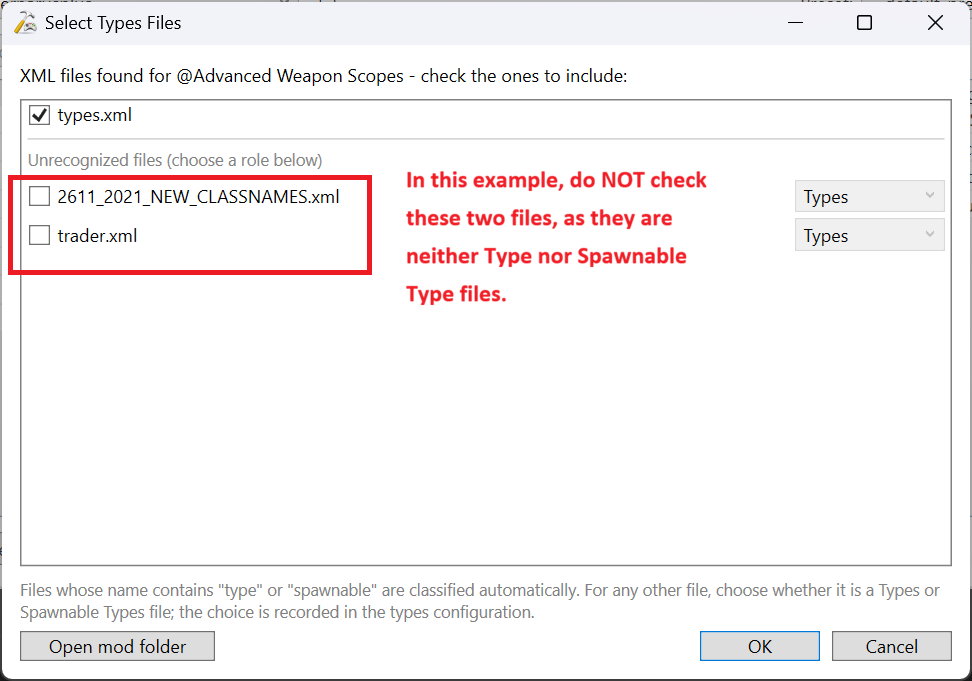

### 3. 快速打开经常需要编辑的文件夹

- **当前地图（Current Map）** 旁边的图标会打开当前预设的 `profiles` 文件夹，你可以在其中编辑 VppAdminTools 等模组的配置。
- **类型配置（Types Config）** 旁边的图标会打开当前预设的 `type_files` 文件夹，其中存放已配置的类型文件。这些模板文件由模组作者提供，并从 Workshop 复制而来；你可以根据需要编辑它们。

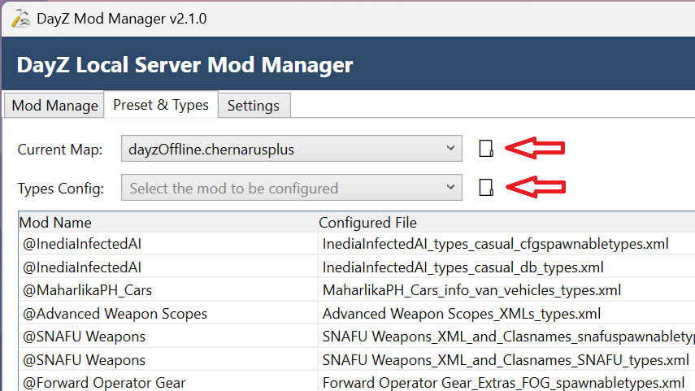

### 4. 编辑预设的服务器配置

- 点击任意一个文件夹图标打开对应文件夹，然后返回上一级目录，即可进入预设文件夹。
- `serverDZ.cfg` 就存放在该预设文件夹中。你可以根据需要编辑其中的设置。

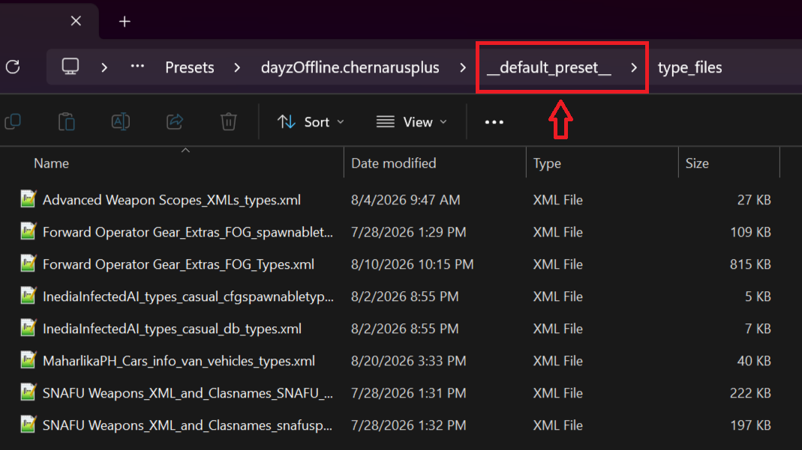 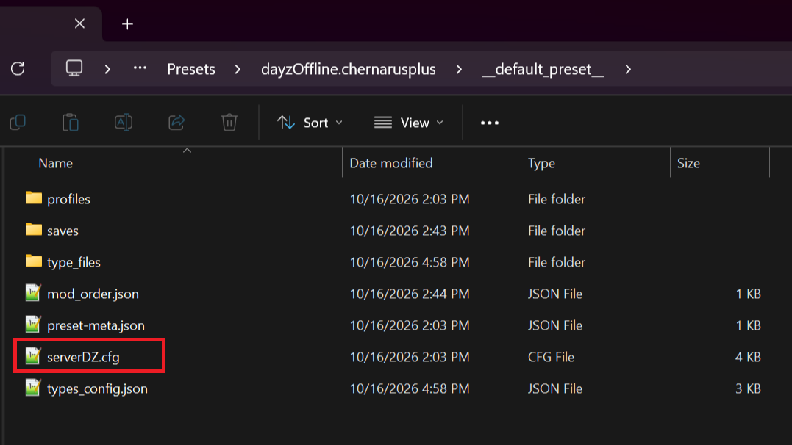

> [!WARNING]
> **请勿**修改 **`instanceId = N;`** 这一行。它由 `preset-meta.json` 中保存的预设 `instanceId` 固定指定。修改该值会使服务器指向另一个 `storage_<id>`，从而导致预设与实际世界数据不同步。

### 5. 多选类型文件

- 点击并拖动即可选择多个类型文件，也可以按 `Ctrl+A` 全选。

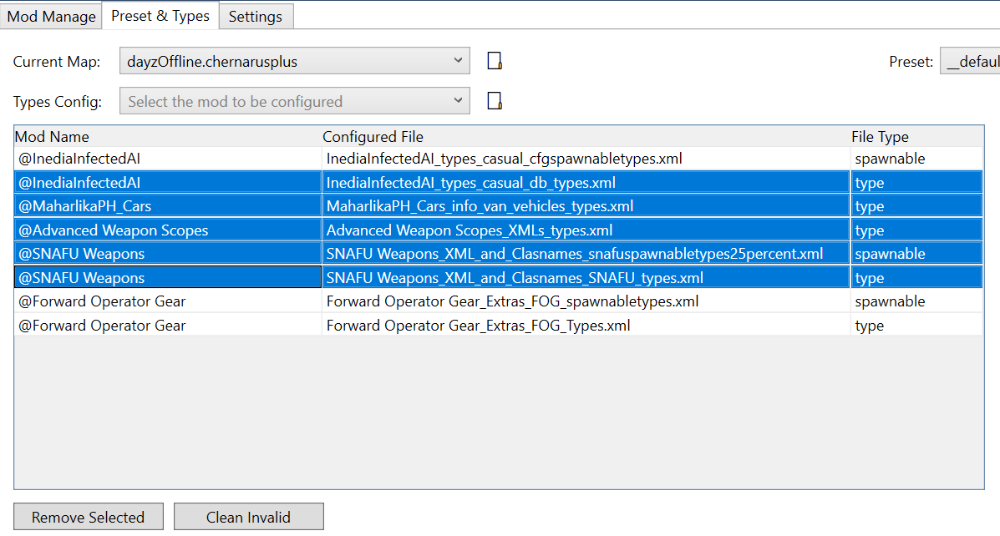

### 6. 实时世界存储状态指示灯

主窗口右下角有一个小型圆形指示灯，它会在所有选项卡中一直可见，用于指示当前预设是否拥有实时世界。

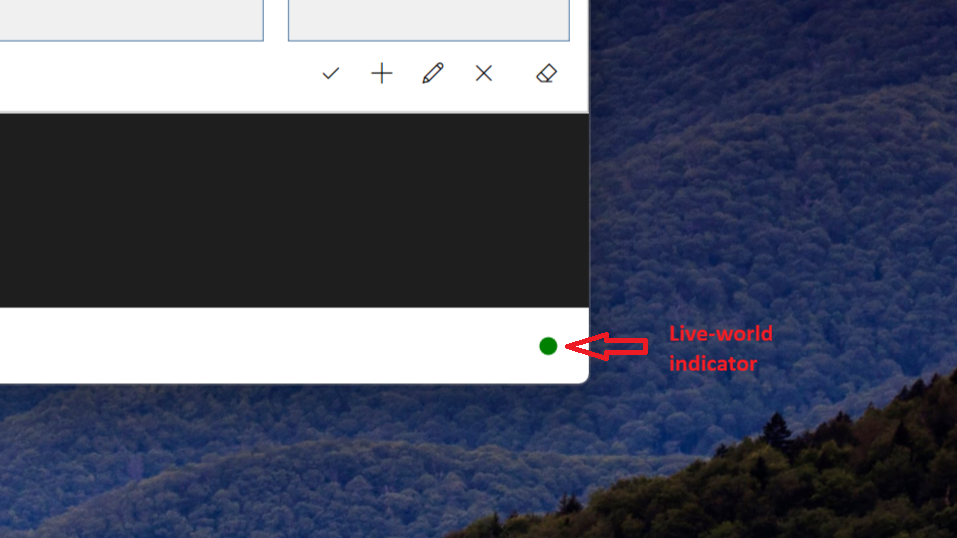


- **绿色** — 当前预设的实时存储文件夹 `mpmissions\<currentMapName>\storage_<instanceId>` 已存在于磁盘中。将鼠标悬停在指示灯上，可以查看对应文件夹。
- **浅灰色** — 该文件夹不存在。悬停提示会显示预期的 `storage_<instanceId>` 文件夹。
- 指示灯只检查当前预设自己的存储文件夹。**进度存档（Progress Saves）** 列表中显示的孤立 `storage_<id>` 文件夹不会影响指示灯状态。
- 切换预设或地图、应用配置，以及执行保存/清除世界操作时，指示灯都会自动更新。

### 7. 重要限制：无法完全隔离模组配置

虽然预设可以隔离大部分服务器状态，包括 `profiles`、`type_files`、模组目录联接、预设专属的 `serverDZ.cfg` 以及各预设独立的世界存储，但 **V2 无法保证所有模组都能实现完整的环境隔离**。

有些模组会在预设管理的 `profiles` 目录**之外**写入运行时生成的配置文件或数据文件夹。
一个常见例子是 `DayZ-Expansion-AI`，它会在以下位置维护一套独立的配置文件：
```
mpmissions\<mapName>\expansion
```
这些位置中的文件不属于 V2 的预设管理范围。**切换预设时，这些文件不会被复制、替换或隔离**。

同一张地图下的所有预设都会共用这些外部模组文件；修改这些文件会影响该地图下的每一个预设。

这是有意为之：自动处理任意模组特有的外部目录会显著增加复杂度，而本工具**并不以实现完整的模组环境隔离为目标**。

如果某个模组将所有配置都保存在 `profiles` 文件夹中，它就会按预期实现隔离。
如果你使用的模组会在 `profiles` 之外写入数据，那么在同一张地图下使用多个预设时，你必须手动备份、管理或切换这些外部文件夹。

### 8. 可选：移除 BattlEye，仅用于本地游戏
由于 V2 专门面向私人本地单人服务器，**BattlEye 反作弊系统对这一使用场景没有实际帮助**，反而会带来不必要的后台 CPU 和 I/O 性能开销。

你可以使用社区工具 **DayZ-Server-Battleye-Remover** 修补 `DayZServer_x64.exe`，以绕过 BattlEye：
> https://github.com/JonathanEke/DayZ-Server-Battleye-Remover

> [!CAUTION]
> 此可执行文件补丁**仅供本地私人用途**。切勿在任何可通过公网访问的服务器上运行修改后的二进制文件。这是一个外部第三方工具，并非由本项目维护；如遇到错误或问题，请向其原始 GitHub 仓库反馈。

### 9. 服务端模组加载（-serverMod=）不受工具管理
本工具主要用于管理 `-mod=` 参数和完整的预设环境，足以覆盖本地单人 / PvE 游戏中的大多数模组使用场景。

在本地单人游戏中，`-serverMod=`（仅在服务端加载模组）的实际用途很少，维护成本远高于其带来的收益。与上文第 7 点所述的限制一致，本工具并**不打算支持所有可能的模组加载场景**。

**需要使用 `-serverMod=` 的高级用户请注意：**
> 重要说明：对于添加到 `-serverMod=` 的模组，DZMMV2 **不会创建目录联接**。这些模组无法引用 Steam 的 `!Workshop` 文件夹中的文件。模组文件夹必须以实体副本的形式直接拷贝到 DayZServer 根目录中。点击 Apply 或切换预设时，管理器绝不会覆盖或修改此批处理文件变量。

手动配置步骤：
1. 在 Steam 的 `!Workshop` 目录中找到目标纯服务端模组文件夹（文件夹名称以 `@` 开头）。将该**完整的实体模组文件夹**复制到 `DayZServer` 根目录中。
2. 打开启动 `.bat` 文件，在 `serverMod` 变量中填写模组名称。多个模组之间使用分号 `;` 分隔。

批处理配置示例：
```bat
set "serverMod=-serverMod=@MyServerMod;@AnotherServerOnlyMod"
```

---

## 功能特性

### 模组管理

- 在已配置的 Workshop 文件夹或自定义文件夹中查找已安装的 DayZ 模组。
- 通过 **已加载（Loaded）** 和 **可用（Available）** 列表，查看当前已启用和可供加载的模组。
- 使用搜索栏快速查找模组。
- 直接加载或卸载模组，也可以在搜索结果中执行这些操作。
- 通过拖拽模组来调整服务器加载顺序。
- 使用 **Remove Missing (移除缺失)** 移除磁盘上已缺失模组的列表条目。
- 如果已加载的模组文件夹缺失，V2 会将该模组标记为缺失。
- 点击 **Apply（应用）**，将所选模组配置应用到本地服务器。

### 目录联接与批处理文件管理

- 加载模组时，V2 会通过 Windows 文件夹链接（称为目录联接，junction）让服务器访问这些模组。这些链接位于 `DZMMV2_ModList` 中，并按预设分别存放在独立的子文件夹内（例如 `DZMMV2_ModList\1\@CF`）；子文件夹以对应预设的 `instanceId` 命名。切换预设不会重新创建或删除其他预设的目录联接。
- 模组路径采用相对于 DayZ Server 根目录的写法，例如 `DZMMV2_ModList/1/@CF`。（在批处理文件中，这些路径使用正斜杠。）

```
📂 DZMMV2_ModList/
├── 📂 1/                    → instanceId 为 1 的预设的目录联接文件夹
│   ├── 🔗 @CF               → 目录联接 → Steam Workshop\...
│   └── 🔗 @AnotherMod       → 目录联接 → Steam Workshop\...
│
├── 📂 2/                    → instanceId 为 2 的预设的目录联接文件夹
│   ├── 🔗 @CF
│   └── ...
│
└── 📂 3/ ...
```

- 点击 Apply 时，V2 会更新批处理文件中的 `modList` 部分。该部分由 V2 管理。
- 如果加载的模组很多，V2 会将列表拆分到多条有效的 `cmd` 命令行中，每行包含十个模组条目，而不是把所有内容放在一条很长的命令行中。
- 点击 Apply 时，V2 会检查现有目录联接，并将其更新为与当前选择的配置一致。
- 删除预设时，也会删除该预设对应的目录联接文件夹。

### 预设与类型配置

#### 地图和预设配置

- 通过检查服务器的 `mpmissions` 目录来查找地图。如果任务文件夹中包含 `cfgeconomycore.xml`，就会被识别为地图。
- 从下拉列表中选择要使用的地图。
- 更新当前预设 `serverDZ.cfg` 中的 `template` 配置行（DayZ 使用 `template` 保存地图名称）。

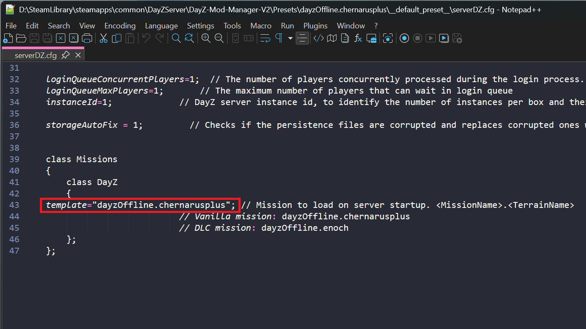

- 更新批处理文件中的 `serverProfile` 和 `serverConfig` 配置行，让服务器使用当前预设的 `profiles` 文件夹和 `serverDZ.cfg`。

#### 类型文件的识别与分配

- 搜索模组内的所有文件夹，查找其中的全部 XML 文件。
- V2 会自动识别文件名中包含 `type` 或 `spawnable` 的文件。其他 XML 文件会单独显示在窗口底部，你可以为每个文件指定 **Types** 或 **Spawnable** 类型。
- 为无法识别的文件指定类型前，用 **Open Mod Folder (打开模组文件夹)** 在文件资源管理器中检查该模组的 XML 文件。
- 将你选中的 XML 文件从 Workshop 复制到当前预设的 `type_files` 文件夹中。
- 在 `types_config.json` 中保存每个文件所分配的类型。V2 会使用这些信息设置 `type` 属性，并在 `cfgeconomycore.xml` 中将每个模组的 types 条目放在 spawnabletypes 条目之前。
- 类型列表会显示 **模组名称（Mod Name）**、**已配置文件（Configured File）** 和 **文件类型（File Type）**（`type` 或 `spawnable`），方便你快速检查每个文件所分配的类型。


#### 战利品经济系统集成
- 在 `cfgeconomycore.xml` 的 `<economycore>` 和 `<classes>` 之间添加 CE 配置块，让 DayZ 能够读取所选类型文件。
- CE 配置块始终使用同一个文件夹路径：`db/DZMMV2_Types`。
  在每个任务目录中，`mpmissions/<mapName>/db/DZMMV2_Types` 下都有一个 Windows 目录联接，指向当前预设的 `type_files` 文件夹。
  切换预设时，V2 会让该任务目录联接指向新预设；切换地图时，则会为新选中的任务目录创建相应联接。`<ce>` 中的 `folder` 属性始终保持为 `db/DZMMV2_Types`。V2 从不会将类型文件本身复制到 mpmissions 中，只会在该位置创建 db/DZMMV2_Types 目录联接。
- `db/DZMMV2_Types` 是文件夹链接（目录联接），而不是文件的另一份独立副本。
- 通过 `DZMMV2_Types` 目录联接编辑 XML 文件（例如使用 VPP Admin Tool 编辑），实际修改的是当前预设 `type_files` 文件夹中的文件。
- 请勿自行重命名、删除或修改 `DZMMV2_Types`；点击 Apply 时由 V2 负责管理。保存、加载或清除世界都不会改变该目录联接的指向。如果目录联接损坏或指向错误位置，点击 Apply 进行修复。
- 如果你手动删除了 V2 的数据目录，`db/` 下可能会遗留一个损坏的目录联接。目录联接本身并不包含类型文件。如需清理，只删除目录联接本身，**不要**删除它指向的文件夹。

- V2 会使用 `dzmmv2-managed-by="DayZ-Mod-Manager-V2"` 标记自己的 `<ce>` 配置块。点击 Apply、切换地图或预设，或者编辑类型文件时，V2 只会更新该标记配置块中的 `<file>` 条目。即使该配置块中没有任何条目，`<ce>` 元素及其标记也会保留。

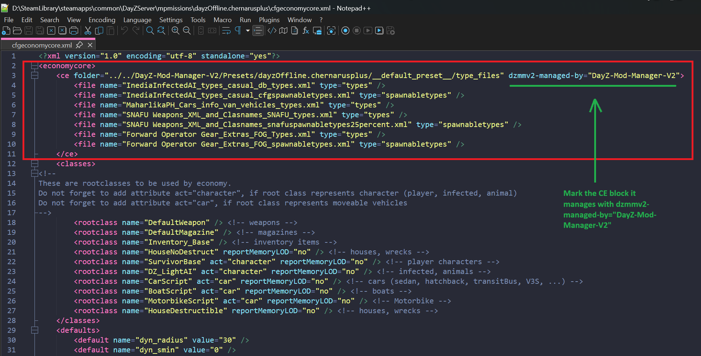

- 对于其他 `<ce>` 配置块，V2 不会进行处理，包括旧版 V2 使用的 `./db/ModTypes` 配置块，以及由其他工具创建的配置块。V2 不会修改自己不负责管理的条目。


#### 类型文件维护

- 如果 `type_files` 中存在某个 XML 文件，但 `types_config.json` 中没有记录该文件，V2 会将其标记为 `(untracked)`。这样，手动编辑遗留的文件、删除失败后残留的文件或旧版本留下的文件仍然可见，你可以将其移除。V2 管理的 `<ce>` 配置块只会引用已追踪的文件。
- 覆盖或删除已配置的类型文件之前，会要求你确认。
- 提供 **Remove Selected（移除所选项）** 和 **Clean Invalid（清理无效项）** 工具，用于清理已配置文件。
- 如果预设已有进度存档或实时世界存储，编辑类型配置前会发出警告。DayZ 会在世界首次创建时读取这些文件，因此修改会影响之后的物品生成以及之后新建的存档，但不会影响当前世界中已经生成的物品。
- 使用 **Types Config** 和 **Current Map** 旁边的按钮，可以在文件资源管理器中打开当前预设的 `type_files` 或 `profiles` 文件夹。

> **从较早的 V2 版本升级：** 旧版本创建的 `<ce>` 配置块没有标记。V2 无法判断该配置块是否由自己创建，因此会保留旧配置块，并在其旁边新建一个带标记的配置块。DayZ 会读取每个 <ce> 配置块中的 <file> 条目，因此在手动删除旧配置块之前，旧块和新块可能会重复引用同一批类型文件。请手动删除旧版 V2 创建的、没有标记的 `<ce>` 配置块。在 2.0.x 版本中，这些配置块指向 `db/ModTypes`，例如 `<ce folder="db/ModTypes">...</ce>`。V2 不会改动其他工具创建的配置块。如果检测到此类配置块，V2 会在日志中发出警告，但不会自动迁移。

### 预设与进度存档

V2 以**预设**为核心进行组织。每个预设都是一套独立的 DayZ 服务器配置，拥有自己的 `serverDZ.cfg`、模组顺序、类型配置、`type_files`、profiles 和 `instanceId`。**存档**则是某个时间点的世界状态快照。一个预设可以包含多个存档；这些存档都属于同一个预设，因此共用同一套服务器配置。

#### 创建和配置预设

- 首次应用某张地图时，V2 会为该地图创建一个 `__default_preset__`。此预设不能重命名或删除。V2 会在首次运行时创建它（前提是已设置服务器路径和批处理文件，并且这是 V2 找到的第一张地图），或者在你选择该地图时创建它。
- 使用 **[Add Preset]** 创建自己的预设。新预设的 `profiles` 文件夹初始为空，不同预设之间不会共享配置文件数据。
- 复制当前预设，可以一并复制其 `serverDZ.cfg`、模组顺序、类型配置和生成的类型文件。**不会复制 Profiles 和存档。** 你也可以将预设复制到另一张地图。在这种情况下，V2 会将复制后的 `serverDZ.cfg` 中的 `template` 行重写为目标地图的名称，并分配一个新的 `instanceId`。
- 预设名称可以使用字母、数字、`.`、`_`、`-` 和 `+`，但**不能包含空格**。名称也不能以句点结尾，或使用 Windows 保留设备名称。V2 会在不加引号的情况下，将当前预设的 `serverDZ.cfg` / `profiles` 路径传递给服务器（`-config=%serverConfig%`、`-profiles=%serverProfile%`）。DayZ Server 不接受带引号的 `-config` 值，因此预设名称中含有空格会导致服务器无法启动。
- 创建预设时，V2 会复制现有的 `serverDZ.cfg`，并且只修改 `template`（地图）和 `instanceId`：
  - 复制预设时，会复制来源预设的 `serverDZ.cfg`。如果该文件不存在，V2 就无法创建副本。
  - 创建新的用户预设时，会复制该地图下 `__default_preset__\serverDZ.cfg`。如果该文件不存在，V2 就无法添加预设。
- `__default_preset__` 会复制 `<serverPath>\serverDZ.cfg`。如果该根目录配置文件中的 `instanceId` 有效，且尚未被任何预设使用，那么默认预设会保留该值。如果另一个预设已经使用了该 ID，V2 就会分配一个新 ID 并记录警告。每个 ID 对应 `DZMMV2_ModList` 中的一个子文件夹，因此只能有一个预设使用根目录配置文件中的 ID。
- V2 只会在首次创建预设时复制 `serverDZ.cfg`。如果你之后删除了某个已有预设的 `serverDZ.cfg`，V2 会报告文件缺失，但不会重新创建；再次使用该预设之前，请手动恢复此文件。对于 `__default_preset__`，如果 `preset-meta.json` 缺失，V2 会自动重建该文件，**并保留原有的 `instanceId`**。如果用户创建的预设缺少此文件，V2 会将该预设报告为不完整。若要重新创建默认预设，请删除其 `__default_preset__` 文件夹；下次应用该地图时，V2 会再次创建它。

#### 世界与存档管理

- 同一张地图下的不同预设通过使用不同的 `instanceId` 来保存各自独立的世界。因此，切换预设不会覆盖其他预设的实时世界（`storage_<instanceId>`）。
- **Add Save** 会复制当前预设的世界进度，复制 `storage_<instanceId>` 并新增 `save-meta.json`。**只有实时世界存储文件夹 storage_<instanceId> 已存在时，Add Save 才能使用**，因此请至少先启动一次服务器。添加存档之前，请确认实时世界指示灯为绿色。
- 加载存档只会还原世界，不会更改预设的模组、类型配置或 profiles。
- 使用 Wipe World 可以删除当前预设的实时世界存储，这样下次启动服务器时就会生成一个全新的世界。实时世界指示灯会变成灰色。
- 如果 `storage_<id>` 不属于任何预设，存档列表会将其标记为 `(orphaned)`。它们可能是删除预设后遗留的文件夹，也可能是在 V2 出现之前就已存在的文件夹；你可以直接从列表中删除它们。
- 删除预设时，会移除该预设文件夹（包括 `serverDZ.cfg`、profiles、存档和 `type_files`），以及对应的 `DZMMV2_ModList\<instanceId>` 目录联接文件夹。但它**不会**删除 `mpmissions/<mapName>` 下的实时世界 `storage_<instanceId>`。该世界会在 **Progress Saves** 列表中显示为 `(orphaned)` 存储。如果不再需要，可以在列表中单独将其删除。
- 使用 Save、Load、Wipe 或 Rename Save，或者切换、重命名、删除预设之前，必须先停止 DayZ Server。
- 加载存档时，当前实时世界存储会被存档副本替换。

> **已有世界：** 如果某个现有 `storage_<instanceId>` 文件夹的 ID 与预设的 `instanceId` 匹配，并且该文件夹位于 `mpmissions/<mapName>` 下，V2 就会将该预设连接到这个世界。V2 仅根据 ID 是否匹配来判断归属，不提供单独的“将此文件夹关联到某个预设”操作。没有匹配预设的世界会在 **Progress Saves** 列表中显示为 `(orphaned)`，并且可以删除。

### 设置与数据存储

V2 会将设置和存档数据保存在专用文件夹中。

尚未配置服务器路径时：

```text
%LOCALAPPDATA%\DayZ-Mod-Manager-V2
```

配置服务器路径后：

```text
<serverPath>\DayZ-Mod-Manager-V2
```

更改服务器路径并成功点击 Apply 后，V2 会将数据文件移动到新位置。`%LOCALAPPDATA%` 中的一个小型指针文件会记住数据文件夹的位置，以便 V2 下次启动时使用。

数据文件夹的内容如下：

```text
DayZ-Mod-Manager-V2\
├─ settings.json
└─ Presets\
   └─ <mapName>\
      ├─ __default_preset__\
      │  ├─ preset-meta.json
      │  ├─ serverDZ.cfg
      │  ├─ mod_order.json
      │  ├─ types_config.json
      │  ├─ type_files\
      │  ├─ profiles\
      │  └─ saves\
      │     └─ <saveName>\
      │        ├─ save-meta.json
      │        └─ storage_<id>\
      └─ <userPreset>\
         └─ (same structure)
```

V2 会将每个预设的 `instanceId` 保存在 `preset-meta.json` 中（也可以回退到从 `serverDZ.cfg` 读取）。该 ID 会告知 DayZ 应使用哪个实时世界文件夹：`mpmissions\<mapName>\storage_<instanceId>`。

设置选项卡还提供 **启动时自动清理服务器日志文件（Auto-clean server log files on startup）**。启用后，只有当前预设的 `profiles` 文件夹中 `.rpt` 和 `.log` 文件的总数超过 20 个时，V2 才会删除这些文件。如果总数为 20 个或更少，则不会进行清理。此选项**默认关闭**。DayZ 服务器运行时不会清理日志。

切换地图或预设、编辑类型配置、加载存档或清除世界之前，请先停止 DayZ 服务器。

---

## 从旧版本升级

> [!IMPORTANT]
> **v2.1.0** 更改了应用的数据/文件布局，因此与旧版 V2 使用的文件布局不兼容。强烈建议从全新配置开始。请先备份所有需要保留的内容。

### 移除旧版 V2

1. 启动旧版 DayZ 管理器 V2。
2. 在 **模组管理** 选项卡中卸载所有模组，然后在 **预设与类型（Preset & Types）** 选项卡中使用 **[Remove Selected]** 按钮移除所有已配置的类型文件。
3. 关闭应用程序，并删除旧版 V2 的可执行文件（例如 `DayZModManagerV2-v2.0.x-win-x64.exe`）。
4. 删除 `DayZServer\DayZ-Mod-Manager-V2` 文件夹、旧版 V2 使用的 `DayZServer\ModList` 文件夹，以及 `%LOCALAPPDATA%\DayZ-Mod-Manager-V2`。

删除 `ModList` 只会移除文件夹链接，不会删除这些链接所指向的 Workshop 模组。请删除目录联接文件夹本身；不要通过浏览目录联接来删除其中的文件。

### 安装新版本

1. 从 [V2 Releases 页面](https://github.com/RichardVincent1324/DayZ-Local-Server-Mod-Manager-V2/releases/latest) 下载最新的 V2 可执行文件。
2. 从[原始仓库](https://github.com/RichardVincent1324/DayZ-Local-Server-Mod-Manager/blob/main/LocalServer.example.bat)下载最新的 `LocalServer.example.bat`。**每次更新 V2 时都要重新下载一次**，即使你已经有旧版批处理文件。
3. 将这两个文件放入 DayZ Server 根目录。
4. 按照[入门指南](#入门指南)重新配置 V2。

---

## 批处理文件必读说明

`LocalServer.example.bat` 是 V2 正常启动流程所必需的文件。它提供了 V2 设计用于更新和调用的批处理文件结构。

模板包含以下重要设置：

- `serverDirectory` — DayZ Server 的安装目录。
- `modList` — **必需**；应用配置时，V2 会更新这一行。
- `serverProfile` — **必需**；当前预设的 profiles 文件夹（点击 Apply 时由 V2 更新）。
- `serverConfig` — **必需**；当前预设的 `serverDZ.cfg` 路径（点击 Apply 时由 V2 更新；模板中的值仅为占位符）。

模板会启动 `DayZServer_x64.exe`，也可以通过 Steam 启动 DayZ 客户端。你可以随意重命名批处理文件；V2 会使用你在设置中选择的文件。

三行配置（`modList`、`serverProfile`、`serverConfig`）都必须存在。如果缺少任何一行，V2 就会显示错误，并阻止 Apply、地图或预设切换以及 Start Server 操作。

**如果没有完成此批处理文件配置，V2 就无法更新或启动预期的启动程序，因此 Apply、地图/预设切换和服务器启动都无法正常工作。**

---

## 重要：仅适用于本地服务器和单人游戏

V2 专为 DayZ 本地环境、单人游戏和单人 PvE 设计。

它**不提供完整的公共服务器管理工具链**，也不负责管理：

- `.bikey` 部署。
- `.bisign` 文件。
- 服务端签名验证工作流程。
- 远程服务器/无头服务器管理。

如果你运行的是需要签名验证和密钥管理的公共服务器或共享专用服务器，请使用专门为此类用途设计的工具。

---

## 服务器与文件布局

完成设置后，你的服务器目录可能如下所示：

```
<serverPath>\
├─ DayZ-Mod-Manager-V2\
│  ├─ settings.json
│  └─ Presets\
│     └─ <mapName>\
│        └─ <presetName>\
│           ├─ preset-meta.json
│           ├─ serverDZ.cfg
│           ├─ mod_order.json
│           ├─ types_config.json
│           ├─ type_files\
│           ├─ profiles\
│           └─ saves\
├─ LocalServer.bat
├─ DZMMV2_ModList\
│  ├─ 1\                    -> instanceId 为 1 的预设对应的目录联接文件夹
│  │  ├─ @CF                -> 指向 Workshop 模组的目录联接
│  │  └─ @AnotherMod        -> 指向 Workshop 模组的目录联接
│  └─ 2\                    -> 另一个预设对应的目录联接文件夹
│     └─ ...
├─ mpmissions\
│  └─ <mapName>\
│     ├─ cfgeconomycore.xml
│     ├─ db\
│     │  └─ DZMMV2_Types         -> 指向当前预设 type_files 文件夹的目录联接
│     └─ storage_<instanceId>\
└─ DayZServer_x64.exe
```

批处理文件中的 `modList`、`serverProfile` 和 `serverConfig` 配置行会告知服务器使用当前预设的模组、`profiles` 文件夹和 `serverDZ.cfg`。`cfgeconomycore.xml` 中带标记的 `<ce>` 配置块使用固定的任务文件夹路径 `db/DZMMV2_Types`。切换预设时，该路径下的目录联接会指向新预设的 `type_files` 文件夹，因此 V2 不需要将类型文件复制到任务目录中。

---

## 安全机制

V2 的设计目标之一，是降低本地服务器配置遭到意外破坏的风险：

- Apply 会在正式应用配置之前验证环境。
- 新的目录联接会先于旧目录联接的清理准备好，因此即使清理过程中失败，服务器也不会失去可用的模组路径。
- 如果批处理文件写入失败，V2 不会删除现有启动配置仍在引用的目录联接。
- 启动前，V2 会验证任务目录中的类型文件目录联接是否指向当前预设；如果目录联接缺失或指向不匹配，V2 会阻止启动，直到再次执行 Apply。
- 保存/加载时，如果复制操作失败，V2 会报告错误。请注意，加载存档时会先删除实时世界，再复制已保存的世界；如果复制过程在中途失败，实时世界可能只恢复了一部分，因此请务必备份重要世界。
- 当 DayZ Server 进程正在运行时，Save / Load / Wipe World 操作（以及预设切换/重命名/删除）都会被禁止。
- 覆盖或删除由 V2 管理的类型文件之前，类型配置操作会先征求确认。
- 如果已加载的模组缺失，或者引用的类型文件不存在，V2 会阻止启动服务器。
- 如果启动批处理文件缺少任何一行由管理器负责维护的配置（`modList`、`serverProfile`、`serverConfig`），V2 会阻止 Apply、地图/预设切换和 Start Server。
- 由管理器负责的修改仅限于 V2 所负责的配置行和文件。V2 只会读取服务器根目录下的 `serverDZ.cfg`，绝不会写入该文件。

即便如此，仍建议你在进行较大改动之前，备份重要的服务器配置和存档数据。

---

## 系统要求

### 用户

- 64 位 Windows。
- DayZ 独立版（Standalone）。
- 已安装且能够正常运行的 DayZ 本地服务器。
- 已安装的 Workshop 模组（如果你计划使用模组）。
- 兼容的启动 `.bat` 文件。**请按照上文说明，从原始仓库下载 `LocalServer.example.bat`。**

### 开发者

- Windows。
- [.NET 8 SDK](https://dotnet.microsoft.com/download/dotnet/8.0)。
- Visual Studio 2022，或其他支持 .NET 8 和 WPF 的开发环境。

---

## 从源代码构建

获取源代码并克隆仓库：

```powershell
git clone https://github.com/RichardVincent1324/DayZ-Local-Server-Mod-Manager-V2.git
cd DayZ-Local-Server-Mod-Manager-V2
```

构建项目：

```powershell
dotnet build DayZModManagerV2.sln
```

从源代码启动应用：

```powershell
dotnet run --project src/DayZModManager.App
```

运行自动化测试：

```powershell
dotnet test DayZModManagerV2.sln
```

### 发布独立运行的 Windows x64 版本

```powershell
dotnet publish src/DayZModManager.App `
  -c Release `
  -r win-x64 `
  --self-contained true `
  -p:PublishSingleFile=true `
  -p:IncludeNativeLibrariesForSelfExtract=true `
  -p:EnableCompressionInSingleFile=true `
  -p:DebugType=None `
  -p:DebugSymbols=false
```

---

## 项目结构

```text
src/
├─ DayZModManager.Core/       # domain logic and services
└─ DayZModManager.App/        # WPF UI / MVVM application

tests/
├─ DayZModManager.Core.Tests/
└─ DayZModManager.App.Tests/
```

V2 将主要的服务器和模组管理逻辑与 Windows 图形界面分离。这种结构让代码更容易维护和测试。

---

## V1 → V2

V2 是从底层重新构建的版本，而不只是换了一个新界面。

| V1 | V2 |
| --- | --- |
| PowerShell | C# / .NET 8 |
| PowerShell GUI | WPF / MVVM |
| 面向脚本的架构 | 结构化的应用程序架构 |
| 根目录级别的模组目录联接工作流程 | 专用的 `DZMMV2_ModList` 目录联接文件夹 |
| 基础的模组/类型文件工作流程 | 集成地图、类型文件、未追踪文件和安全处理 |
| 缺少存档管理 | 带有元数据和世界快照的命名进度存档 |
| 可测试性有限 | 独立的 Core/App 测试项目 |

原始仓库仍然有用，因为 V2 所需的 `LocalServer.example.bat` 文件目前托管在那里。

---

## 故障排除

### V2 无法找到或更新我的批处理文件

请确认你已从原始仓库下载批处理模板，将它放在 DayZ Server 文件夹中，并在 V2 的设置中选中了该文件。模板必须包含全部三行由 V2 管理的配置：`set "modList=-mod=...`、`set "serverProfile=...` 和 `set "serverConfig=...`。如果缺少其中任何一行，V2 都会显示错误，并阻止 Apply 和 Start Server。

**模板：**
https://github.com/RichardVincent1324/DayZ-Local-Server-Mod-Manager/blob/main/LocalServer.example.bat

### 模组没有出现在可用列表中

- 模组下载完成后，至少启动过一次 DayZ 客户端。Steam 只负责下载模组，DayZ 客户端运行后才会把它们写入 `!Workshop`。
- 在 DayZ 客户端运行之后重新打开过 V2，并刷新了**可用**列表。

### 模组无法正常加载

请检查以下项目：

- Workshop 路径是否指向直接包含 `@...` 模组文件夹的目录。
- 你想使用的模组是否位于 **已加载（Loaded）** 列表中。
- Apply 是否已成功完成，且没有出现错误。
- 是否存在生成的 `DZMMV2_ModList\<instanceId>` 目录联接文件夹。
- 所选批处理文件中是否包含由 V2 写入的模组列表。
- 对于此本地/单人配置，是否已设置 `verifySignatures = 0;`。

### 服务器无法启动

尝试手动运行批处理文件，然后检查以下项目：

- `serverDirectory` 是否指向你的 DayZ Server 文件夹。
- 该文件夹中是否存在 `DayZServer_x64.exe`。
- 服务器根目录和当前预设文件夹中是否都存在 `serverDZ.cfg`。
- 服务器端口和其他启动设置是否正确。
- 当前预设的 `serverDZ.cfg` 中是否设置了 `verifySignatures = 0;`。对于较早创建的预设，请检查预设自身的配置文件；之后修改服务器根目录下的配置文件不会更新已有预设。
- 点击 Start Server 时，V2 是否报告存在缺失的模组或类型文件。

### 自定义物品不会生成

在 **预设与类型（Preset & Types）** 中，检查所需的 XML 文件是否位于当前预设的 `type_files` 文件夹中，以及是否已列入 `cfgeconomycore.xml`。

修改类型文件不会改变当前世界中已经生成的物品。若要让更改应用于一个全新的世界，请清除当前世界或从新存档开始。

### Add Save 提示不存在存储文件夹

至少启动一次服务器，让 DayZ 创建世界文件夹。`Add Save` 会复制实时的 `storage_<instanceId>` 文件夹，因此只有该文件夹存在后才能创建存档。

### Save / Load / Wipe World 不可用

请先停止 DayZ Server。当服务器正在运行时，V2 会禁止可能改变世界状态的存档和预设操作。

### 预设缺失或不完整

V2 会报告具体缺少的内容，例如预设文件夹、`preset-meta.json` 或 `serverDZ.cfg`。对于 `__default_preset__`，删除其文件夹后，V2 会在下次应用地图时重新创建它。对于用户创建的预设，请恢复缺失的文件，或者删除并重新创建该预设。已删除预设的实时世界仍会作为 `(orphaned)` 存储保留，并且可以从存档列表中移除。

---

## 参与贡献

欢迎提交错误报告、建议和改进意见。

提交问题时，请尽量说明：

- 你当时想要执行什么操作。
- 你预期会发生什么。
- 实际发生了什么。
- 相关的错误消息或截图。
- 相关的 DayZ/服务器设置。

请通过此仓库提交问题报告或 Pull Request。

---

## 许可证

本项目采用 [MIT License](LICENSE) 许可。

---

## 免责声明

这是一个由社区独立制作的工具。

**DayZ** 是 Bohemia Interactive 的商标。本项目与 Bohemia Interactive 没有任何关联，也未获得该公司的认可。

---

## 相关链接

- [下载最新 V2 版本](https://github.com/RichardVincent1324/DayZ-Local-Server-Mod-Manager-V2/releases/latest)
- [V2 项目仓库](https://github.com/RichardVincent1324/DayZ-Local-Server-Mod-Manager-V2)
- [原始 V1 项目仓库](https://github.com/RichardVincent1324/DayZ-Local-Server-Mod-Manager)
- [必需的 `LocalServer.example.bat` 模板](https://github.com/RichardVincent1324/DayZ-Local-Server-Mod-Manager/blob/main/LocalServer.example.bat)
